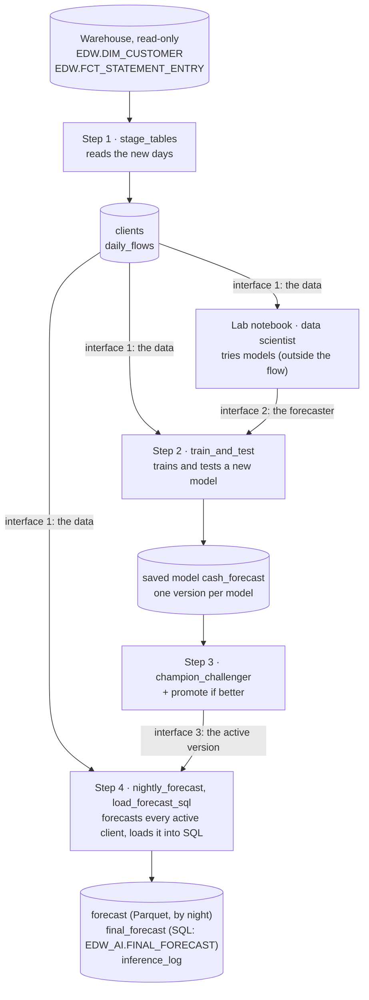

# Digital Cash Management Forecast: how it works

For every active business client, the project forecasts the **net cash flow** (money in minus money out) of the
**next 30, 60 and 90 days**, **per category and in TOTAL**, as a low value (**P10**), an expected value (**EV**) and
a high value (**P90**), in SAR.

Every night, the forecast uses all the data **up to yesterday** (the **cut-off day**). On November 14, the data goes
up to November 13, and the 3 windows are November 14 – December 13 (days 1–30), December 14 – January 12 (days
31–60) and January 13 – February 11 (days 61–90).

This project builds everything **around** the model: getting the data, testing and promoting models, and the nightly
forecast. The model itself is a placeholder until the data scientist's models replace it.

How to run it at the bank: [`forecast/README.md`](../forecast/README.md).

---

## 1. The flow, end to end

| Step | Recipe | Reads | Writes | Runs in |
|---|---|---|---|---|
| 1. Get the data | `stage_tables` | the 2 warehouse tables | `clients`, `daily_flows`, `staging_log` | every scenario |
| 2. Train and test | `train_and_test` | interface 1 | a run in Experiment Tracking, a new **inactive** version of `cash_forecast`, `test_results` | Retrain |
| 3. Promote | `champion_challenger`, then "promote if better" | interface 1, the new and the active version | `promotion_log`; activates the new version if it passes | Retrain |
| 4. Forecast | `nightly_forecast`, then `load_forecast_sql` | interface 1, interface 3 | `forecast` (folder), `inference_log`, then `final_forecast` (SQL table) | Nightly batch |
| Lab (not in the flow) | the notebook `forecast_lab.ipynb` | interface 1, the production model | lab runs in Experiment Tracking (experiment `cashflow_lab`) | by hand |

**The steps only meet through 3 interfaces** (section 3). A step never reads another step's internals: inference,
for example, reads nothing from training except the active version of the saved model.

## 2. Who owns what

| Zone in the flow | Owner | Job |
|---|---|---|
| Raw data, Staging | you | read the warehouse, build `daily_flows` and `clients` (interface 1) |
| Training | data scientist (model), you (pipeline) | train, test, track and promote models (promotion rules are project variables) |
| Inference | you | forecast every active client each night with the active model, log it, load it into SQL |
| (no zone) Lab notebook | data scientist | try models without touching production; hand over a forecaster (interface 2): set the project variable `forecaster`, run Retrain |

---

## 3. The interfaces

### Interface 1: the data (Staging → Training, Inference, the lab notebook)

Every model gets these 2 datasets and nothing else.

**`daily_flows`**: one row per client, day and category, over each client's whole history up to the cut-off day
(yesterday). It is a Dataiku **folder of Parquet files**, not a dataset: read straight from the files, it is about
35 times faster than a dataset (Dataiku's dataset reader handles about 0.4M rows a second, whatever the format).
**One file per group of clients and calendar month** (`group_0007/2026-11_<run>.parquet`; about 5,000 clients per
group, and a client never changes group), so the nightly forecast reads only each group's last 13 months, and each
night only rewrites the current month's files. A small file keeps each client's first posting day, and
`manifest.json` lists the current files.

| Column | Meaning |
|---|---|
| `client_no` | the client (CIF), text |
| `day` | the value date |
| `category` | from the posting's transaction type (`TRNS_TYP`), through the list in `warehouse.py`; unknown types go to `OTHER` |
| `money_in`, `money_out` | the day's credits and debits, SAR, both positive |
| `postings` | how many postings |

Reversed postings (and what they reverse) and transfers between the client's own accounts are left out.

`daily_flows` is kept **grouped by client**: each file holds complete clients. Read it with the project library:
- `cashflow.read_daily()`: all of it as one table (fine for the sample data);
- `cashflow.iter_clients("daily_flows", 5000)`: 5,000 complete clients at a time, without loading it all. Inference
  does this; training can too.

**`clients`**: one row per business client: `client_no`, customer type, line of business, legal entity, ID type,
segment, sector, industry, city, `status` (`ACTIVE` / `CLOSED`), `sole_proprietor`. Business clients = the bank's rule:
`PRIME_RM LIKE '12%' OR SCTR_DSC = 'Sole Proprietorships'`, current row `END_DT = DATE '2199-12-31'`. Personal fields are never read.

### Interface 2: the forecaster (lab notebook → Training)

A forecaster is a small Python class. Any class that follows it can be tested, tracked, promoted and run every night,
with no other change to the project.

| Part | What it does |
|---|---|
| `name`, `params` | its name (the project variable `forecaster` picks it) and its settings |
| `fit(daily, clients, cutoff)` | learns from `daily_flows` and `clients` known at the cut-off day (`cutoff`: the last day of data) |
| `predict(daily, clients, cutoff)` | returns one row per client, category (and `TOTAL`) and window (1, 2, 3: days 1–30, 31–60, 61–90 after the cut-off day): `client_no`, `category`, `window`, `p10`, `ev`, `p90` |

**What a model gets at night:** each client's daily flows of the **last 365 days** up to the cut-off day (a
forecaster can ask for another number with `params["input_days"]`). `cashflow.day_matrix(daily, cutoff)` lays them
out as one row per client and category (and `TOTAL`), one column per day. How to turn the days into features is the
forecaster's own choice: the pipeline does not sum them.

Two rules: a client's forecast may only depend on that client's own data (inference sends clients in chunks), and
P10 ≤ EV ≤ P90 (the project enforces it).

The data scientist's forecasters go in `forecasters.py` (project library). The setup never overwrites that file.

### Interface 3: the active version of `cash_forecast` (Training → Inference)

Each training run is one model with its own **model ID** (for example `CFF_20261031_20261107T1000`: cut-off day,
training time). It becomes a **version** of the saved model `cash_forecast`. The **active** version is the
production model; the nightly forecast always uses it. Rolling back means activating an earlier version.

### The output: the folder `forecast`, then the SQL table `final_forecast`

**One row per active client.** Each night's forecast is a subfolder of Parquet files (one per group of clients),
`forecast_<cut-off>_<model ID>`, kept; `current.txt` points to the newest. The SQL table of the setup's
`FORECAST_SCHEMA` and `FORECAST_TABLE` on `FORECAST_CONNECTION` (by default `EDW_AI.FINAL_FORECAST` on `cm_test_env`;
in the Flow, the dataset `final_forecast`, linked to it) holds the current one. The setup creates that table with SQL
when it is not there (and adds the columns a newer version writes), with the settings' name, not one Dataiku picks.
On Oracle the recipe writes it with `oracledb` (in the code env), logging in with the connection's login, which
Dataiku gives only if the connection's "Details readable by" includes your group; on another database, through
Dataiku's writer into `final_forecast`. The recipe reads where to write from the project variables
`forecast_sql_connection`, `forecast_sql_schema` and `forecast_sql_table`, which the setup sets.

| Columns | Meaning |
|---|---|
| `client_no` | the client |
| `cutoff_date` | the last day of data (yesterday) |
| `w1_start`, `w1_end`, `w2_start`, `w2_end`, `w3_start`, `w3_end` | the first and last day of each window: days 1–30, 31–60, 61–90 after the cut-off |
| `status` | `OK`; `NOT_ENOUGH_HISTORY` (under 365 days since its first posting: no values); `NO_POSTINGS` (no posting in the last 365 days: no values) |
| `history_days` | days from the client's first posting to the cut-off |
| `TOTAL_w1_p10`, `TOTAL_w1_ev`, `TOTAL_w1_p90`, … `UTILITIES_w3_p90` | one column per category (TOTAL first), window and value. Empty for a category the client doesn't have |
| `model_id`, `forecaster`, `load_id` | which model and which warehouse load produced it |

---

## 4. Each step in more detail

### Step 1: get the data (`stage_tables`)

- **Read-only.** Nothing is created or written in the warehouse. The only queries are our own read-only
  `SELECT`s (`table_query`, `daily_totals_query` in `warehouse.py`). They name the columns, so they don't depend on
  the column list Dataiku keeps for each table (an empty list there caused "Invalid number of columns" in the old
  project). Each query is printed in the job log (`PROGRESS SQL:`).
- **Which tables:** the setup's settings `CLIENTS_SCHEMA`, `CLIENTS_TABLE`, `POSTINGS_SCHEMA`, `POSTINGS_TABLE` (by
  default `EDW.DIM_CUSTOMER` and `EDW.FCT_STATEMENT_ENTRY`), both through `EDW_CONNECTION`: one query joins them, so
  they must be on the same connection. In the Flow they stay the datasets `DIM_CUSTOMER` and `FCT_STATEMENT_ENTRY`,
  each linked to its table; the queries use each dataset's own table name.
- **The warehouse does the heavy work, so little travels:**
  - Clients: the bank's own conditions (`warehouse.py`): business clients `PRIME_RM LIKE '12%' OR SCTR_DSC =
    'Sole Proprietorships'` (`CLIENTS_BUSINESS`), and only each one's current row `END_DT = DATE '2199-12-31'`
    (`CLIENTS_CURRENT_ROW`): about 420k rows, one per customer, out of about 520 million (`DIM_CUSTOMER` keeps
    history). If it ever sends several rows per client, staging warns.
  - Postings: Oracle sums them into **daily totals** per client, day and category, for business clients only,
    without reversals and own-account transfers. Only those totals come back, not every posting. The table is
    partitioned by month on its load date `AS_OF_DT`: the query also filters on it (from 31 days before the first
    value day read), so Oracle reads only the partitions needed. The first read still scans the big history
    partition once; each night then reads only the latest one or two. The rules are the
    same as the earlier Python version: tested to give identical `daily_flows` on PostgreSQL and on Oracle.
- **Only the new days from the warehouse.** The first run reads the history once: the last `HISTORY_MONTHS` months up to the cut-off day (a setup setting; `-1`: everything), for all business clients or only the first `CLIENTS_LIMIT` (to test fast). Under 18 months the setup only stages the data: training needs 18. After that, each night
  reads only the postings after the last day already in `daily_flows`, up to the cut-off day (yesterday).
- **By group of clients and month.** New days go to the files of their group and month (usually only the current
  month of each group is rewritten). New files are written beside the old ones and `manifest.json` only switches to
  them once every file is written, so a failed run leaves `daily_flows` as it was. When there is nothing new,
  `daily_flows` is not touched.
- **Cut-off day:** yesterday, or the project variable `cutoff_override` (YYYY-MM-DD). Set by the first step of each
  scenario.
- **Warehouse check:** the second step of each scenario checks that the warehouse's load of the cut-off day (the ETL
  from the source systems) is finished. **It is a mock for now** (`check_warehouse_loaded` in `warehouse.py`, always
  passes), to replace with the bank's real check, for example a read-only query on the warehouse's load-control
  table.
- **Late load check:** if the warehouse has no posting up to the cut-off day, staging stops and changes nothing. The
  next run reads the same days again.
- **Full rebuild** (a scenario run by hand) empties `daily_flows` and reads the history again (the last `HISTORY_MONTHS` months). Use it after a
  reversal cancels a posting from a day already staged, or after the category list changes.
- Big reads never sit in memory whole: the daily totals are spread over files on the server's disk by client and
  written one group of clients at a time.
- **Progress in the job log:** each query, a line every minute while the warehouse is still running it, then the
  rows read as they arrive.

### Step 2: train and test (`train_and_test`)

- Trains the forecaster named by the project variable `forecaster` (default `daily_catboost`). Needs at least 21
  months of history: a year of input, the 3 windows after it, and the 6 test periods.
- **Test, the same for every model:** trained without the last 6 periods of 30 days, it forecasts the 3 windows after
  each of the 6 test cut-offs (30 days apart) from the data known that day, and is compared with what happened:
  - **EV error (WAPE):** total of |actual − EV| ÷ total of |actual|. Lower is better; it should beat the simple guess
    (the same as the 30 days before).
  - **P10–P90 coverage:** share of actual windows between P10 and P90. The aim is about 80%.
- Records the run in Experiment Tracking (experiment `cashflow_forecast`): forecaster, settings, data used (cut-off,
  load, rows, clients), test scores, the model. Deploys it as a new **inactive** version of `cash_forecast`.

### Step 3: promote (`champion_challenger`, then "promote if better")

Tests the new model and the production model on the same 6 periods, then activates the new one only if it passes
the **promotion rules**, which are project variables (no code change needed):

| Project variable | Default | Promoted only if |
|---|---|---|
| `promotion_min_coverage`, `promotion_max_coverage` | 0.70, 0.90 | its P10–P90 coverage is in this range |
| `promotion_beat_simple_guess` | true | its EV error is below the simple guess's |
| `promotion_min_gain` | 0.0 | its EV error is below the production model's by more than this share (a tie keeps production) |

With no production model yet, the first model is promoted. Every decision, its reason and the rules used go to
`promotion_log`.

### Step 4: forecast (`nightly_forecast`), then the SQL load (`load_forecast_sql`)

- Loads the active version of `cash_forecast`.
- **Polars from start to end, the groups of clients side by side** (project variable `inference_workers`, default 4,
  threads: Polars, Parquet and CatBoost work outside Python's lock). Each group, on its own: reads its last 13 monthly
  files, keeps the last 365 days of its active clients, builds the model's input rows (`cashflow.model_rows`: client,
  category, window, `day_365 … day_1`), calls the model's `predict_rows`, makes one row per client, and writes one
  Parquet file into tonight's subfolder of `forecast`. Memory holds the groups being worked on, whatever the number of
  clients. The code is `forecast.forecast_all`: the load test project runs the same code.
- A client with less than 365 days of history gets `NOT_ENOUGH_HISTORY` (it is not sent to the model); one with no
  posting in the last 365 days, `NO_POSTINGS`.
- `current.txt` points to tonight's subfolder **only once every group has worked**: a failed run leaves the previous
  forecast current.
- Adds one row to `inference_log` (section 6).
- **Then the SQL load**, the scenario's next step: the current subfolder into the forecast's table (`final_forecast`),
  replacing the previous one in one transaction on Oracle. If it fails, the forecast is still complete in the folder: build `final_forecast` alone to retry.

### The placeholder model: `daily_catboost` (option A)

- **One model:** CatBoost with the MultiQuantile loss gives P10, EV and P90 together (the EV is the median, which a
  few huge amounts throw off far less than the mean).
- **Shared by every category and the 3 windows:** each client and category is 3 rows with the same inputs; only the
  window (1, 2, 3) changes. So there is one model to track and promote.
- **Inputs:** the net cash flow of each of the last 365 days (one column per day, scaled so small and large clients
  look alike), the category and the window. No sums over 30 days, no calendar: the data scientist decides the
  features.
- **Target in training:** the net cash flow of the window (the sum of its 30 days). Each window is forecast straight
  from the real days, never from the model's own forecast of the month before.
- **Trained on rolling cut-offs:** every 30 days back from the cut-off, the year before it as input and the 3 windows
  after it as targets.
- The lab compares it with `recent_average` (no machine learning). Small models only, no deep learning.

---

## 5. When things run: the scenarios

| Scenario | Steps | Trigger |
|---|---|---|
| **Nightly batch** | set the cut-off day → check the warehouse load → step 1 → step 4. Never trains. | daily, 06:00 Riyadh |
| **Retrain, test and promote** | set the cut-off day → check the warehouse load → step 1 → step 2 → step 3. Never forecasts: the next Nightly batch uses the new active version. | monthly, on the 5th, 07:00 Riyadh |
| **Full rebuild of the daily flows** | set the cut-off day → check the warehouse load → empty `daily_flows` and `staging_log` → read the history again (the last `HISTORY_MONTHS` months) | by hand |

## 6. What gets logged

| Where | One row per | What it says |
|---|---|---|
| `staging_log` | staging run, **also failed ones** | `status` / `error`, mode (`FULL`, `NEW_DAYS`, `NOTHING_NEW`), days read, postings in the daily totals read and kept (business clients, without reversals and own transfers), daily rows added and in total, last day staged |
| Experiment Tracking | training run, and lab try | forecaster, settings, data used, test scores, the model |
| `promotion_log` | promotion decision | candidate and production scores, decision, reason, rules used |
| `inference_log` | forecast run, **also failed ones** | `status` / `error`; `model_id` and `forecaster`; `active_clients` = `clients_ok` + `clients_not_enough_history` + `clients_no_postings`; workers, groups, rows read; seconds reading, preparing, model, formatting, writing (added up over the workers) and in all; peak memory; the output's subfolder |

**Alerts** (an email or a Teams message when a run fails) are planned, not built:
[`forecast/alerts_plan.md`](../forecast/alerts_plan.md). Model monitoring (accuracy against actuals, drift) is the
data scientist's side.

## 7. Scale

Built for the bank's ~420,000 clients. The nightly forecast (step 4), measured on the local Docker Dataiku with
fake clients, the earlier 3-model placeholder (12 periods of 30 days as inputs) and chunks of 5,000 clients:

| Clients | Daily rows read | Reading | Forecasting | Writing | Total | Peak memory |
|---|---|---|---|---|---|---|
| 400,000 | 131M | 1.4 min | 2.2 min | 1.1 min | **4.7 min** | 1.6 GB |
| 800,000 | 262M | 3.7 min | 4.4 min | 2.3 min | **10.4 min** | 1.8 GB |

- Reading `daily_flows` as Parquet files cut the total from 8.5 to 4.7 min at 400k (from 19.2 to 10.4 min at 800k)
  compared with a Dataiku dataset.
- Memory barely moves when the clients double: it holds one chunk of clients at a time.
- **Today's pipeline** (groups of clients by month, Polars, `daily_catboost`, groups side by side), on the sandbox's
  5,000 fake clients, forecast then SQL load: about 2,100 clients a second with 1 worker, 2,900 with 2, 4,000 with 4
  (the earlier one: about 1,000), so roughly 3–5 minutes for 420,000 clients. To confirm on the bank's server.
- The **load test project** (`build_load_test_project.ipynb`, a project of its own, the same code) runs this test on
  the bank's server: one scenario, a list of tests in step 1 (each: data size, workers) run in one go, compared
  side by side and with the earlier ones in a report (the forecast and the SQL load, the share of each step, memory).
- Not tested yet: training on all clients (it still loads all of `daily_flows`); train on a sample of clients if it
  gets too heavy.

## 8. Decisions and open points

**Agreed**
- Input: each client's daily flows per category, the last 365 days up to yesterday. Output: per client, category and
  TOTAL, the next 30, 60 and 90 days, P10 / EV / P90, one row per client.
- Small models only. Placeholder `daily_catboost` (option A: one model, the 3 windows as an input) until the data
  scientist's models are ready.
- Every model is tracked, deployed as a version, and activated only if it passes the promotion rules.
- The warehouse is only read (read-only `SELECT`s of the columns used), never written to. The daily flows and the
  forecast are Parquet files (for speed); the forecast is then loaded into a SQL table on a database the project may
  write into (`FORECAST_CONNECTION`, `FORECAST_SCHEMA`.`FORECAST_TABLE`, made by the setup; `final_forecast` in the
  Flow); the logs and small tables are CSV files.
- At least 365 days of history to get a forecast. Models are tested on the last 6 periods of 30 days.

**To confirm at the bank**
- The real warehouse check: how to know the load of a day (the ETL from the source systems) is finished, to replace
  the mock `check_warehouse_loaded`.
- The real transaction type codes (`TRNS_TYP`) and their categories, to replace the mock list in `warehouse.py`.
- The codes in `DIM_CUSTOMER` the project relies on: status values, retail line of business, commercial
  registration, sole-proprietor legal entities. If they differ, only `warehouse.py` changes.
- How long the first full read of `FCT_STATEMENT_ENTRY` takes, and the load test project on the bank's server.
- Alerts: email, Teams or both, and the channel name.
