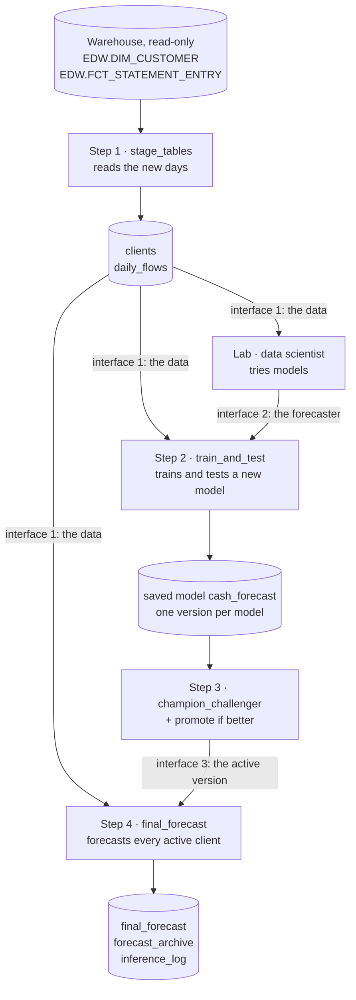

# Digital Cash Management Forecast: how it works

For every active business client, the project forecasts the **net cash flow** (money in minus money out) of the
**next 30, 60 and 90 days**, **per category and in TOTAL**, as a low value (**P10**), an expected value (**EV**) and
a high value (**P90**), in SAR.

Every night, the forecast uses all the data **up to yesterday** (the **cut-off day**). On November 14, the data goes
up to November 13, and the 3 windows are November 14 – December 13 (days 1–30), December 14 – January 12 (days
31–60) and January 13 – February 11 (days 61–90).

This project builds everything **around** the model: getting the data, testing and promoting models, and the nightly
forecast. The model itself is a placeholder until the data scientist's models replace it.

How to run it at the bank: [`forecast/README.md`](../forecast/README.md).

---

## 1. The flow, end to end

| Step | Recipe | Reads | Writes | Runs in |
|---|---|---|---|---|
| 1. Get the data | `stage_tables` | the 2 warehouse tables | `clients`, `daily_flows`, `staging_log` | every scenario |
| 2. Train and test | `train_and_test` | interface 1 | a run in Experiment Tracking, a new **inactive** version of `cash_forecast`, `test_results` | Retrain |
| 3. Promote | `champion_challenger`, then "promote if better" | interface 1, the new and the active version | `promotion_log`; activates the new version if it passes | Retrain |
| 4. Forecast | `final_forecast` | interface 1, interface 3 | `final_forecast`, `forecast_archive`, `inference_log` | Nightly batch |
| Lab | `try_forecaster`, `forecast_lab.ipynb` | interface 1, the production model | `lab_results`, lab runs in Experiment Tracking | by hand |

**The steps only meet through 3 interfaces** (section 3). A step never reads another step's internals: inference,
for example, reads nothing from training except the active version of the saved model.

## 2. Who owns what

| Zone in the flow | Owner | Job |
|---|---|---|
| Raw data, Staging | you | read the warehouse, build `daily_flows` and `clients` (interface 1) |
| Training | data scientist (model), you (pipeline) | train, test, track and promote models (promotion rules are project variables) |
| Inference | you | forecast every active client each night with the active model, archive and log it |
| Lab | data scientist | try models without touching production; hand over a forecaster (interface 2) |

---

## 3. The interfaces

### Interface 1: the data (Staging → Training, Lab, Inference)

Every model gets these 2 datasets and nothing else.

**`daily_flows`**: one row per client, day and category, over each client's whole history up to the cut-off day
(yesterday). It is a Dataiku **folder of Parquet files**, not a dataset: read straight from the files, it is about
35 times faster than a dataset (Dataiku's dataset reader handles about 0.4M rows a second, whatever the format).

| Column | Meaning |
|---|---|
| `client_no` | the client (CIF), text |
| `day` | the value date |
| `category` | from the posting's transaction type (`TRNS_TYP`), through the list in `warehouse.py`; unknown types go to `OTHER` |
| `money_in`, `money_out` | the day's credits and debits, SAR, both positive |
| `postings` | how many postings |

Reversed postings (and what they reverse) and transfers between the client's own accounts are left out.

`daily_flows` is kept **grouped by client**: each file holds complete clients. Read it with the project library:
- `cashflow.read_daily()`: all of it as one table (fine for the sample data);
- `cashflow.iter_clients("daily_flows", 5000)`: 5,000 complete clients at a time, without loading it all. Inference
  does this; training can too.

**`clients`**: one row per business client: `client_no`, customer type, line of business, legal entity, ID type,
segment, sector, industry, city, `status` (`ACTIVE` / `CLOSED`), `sole_proprietor`. Business clients = every line
of business except retail, plus retail clients with a commercial registration. Personal fields are never read.

### Interface 2: the forecaster (Lab → Training)

A forecaster is a small Python class. Any class that follows it can be tested, tracked, promoted and run every night,
with no other change to the project.

| Part | What it does |
|---|---|
| `name`, `params` | its name (the project variable `forecaster` picks it) and its settings |
| `fit(daily, clients, cutoff)` | learns from `daily_flows` and `clients` known at the cut-off day (`cutoff`: the last day of data) |
| `predict(daily, clients, cutoff)` | returns one row per client, category (and `TOTAL`) and window (1, 2, 3: days 1–30, 31–60, 61–90 after the cut-off day): `client_no`, `category`, `window`, `p10`, `ev`, `p90` |

`cashflow.period_matrix(daily, cutoff)` gives each client's net cash flow per 30-day period ending at the cut-off
day, for the models that work that way.

Two rules: a client's forecast may only depend on that client's own data (inference sends clients in chunks), and
P10 ≤ EV ≤ P90 (the project enforces it).

The data scientist's forecasters go in `forecasters.py` (project library). The setup never overwrites that file.

### Interface 3: the active version of `cash_forecast` (Training → Inference)

Each training run is one model with its own **model ID** (for example `CFF_20261031_20261107T1000`: cut-off day,
training time). It becomes a **version** of the saved model `cash_forecast`. The **active** version is the
production model; the nightly forecast always uses it. Rolling back means activating an earlier version.

### The output: `final_forecast`

**One row per active client.**

| Columns | Meaning |
|---|---|
| `client_no` | the client |
| `cutoff_date` | the last day of data (yesterday) |
| `w1_start`, `w1_end`, `w2_start`, `w2_end`, `w3_start`, `w3_end` | the first and last day of each window: days 1–30, 31–60, 61–90 after the cut-off |
| `status` | `OK`; `NOT_ENOUGH_HISTORY` (under 360 days of history: no values); `NO_POSTINGS` (no posting at all: no values) |
| `history_days` | days from the client's first posting to the cut-off |
| `TOTAL_w1_p10`, `TOTAL_w1_ev`, `TOTAL_w1_p90`, … `UTILITIES_w3_p90` | one column per category (TOTAL first), window and value. Empty for a category the client doesn't have |
| `model_id`, `forecaster`, `load_id` | which model and which warehouse load produced it |

---

## 4. Each step in more detail

### Step 1: get the data (`stage_tables`)

- **Read-only.** Nothing is created or written in the warehouse. The only queries are our own `SELECT`s of the
  columns used: `DIM_CUSTOMER` whole, the postings with a date filter on `VAL_DT`. They name the columns, so they
  don't depend on the column list Dataiku keeps for each table (an empty list there caused "Invalid number of
  columns" in the old project).
- **Only the new days from the warehouse.** The first run reads the history once: the last `HISTORY_YEARS` years up to the cut-off day (a setup setting, at least 2; `None`: everything). After that, each night
  reads only the postings after the last day already in `daily_flows`, up to the cut-off day (yesterday).
- **Kept grouped by client.** When there are new days, staging writes `daily_flows` again with the new days in
  place: each client's rows together, old and new, a group of clients per Parquet file. It writes a new version of
  the files and only switches to it once every file is written, so a failed run leaves `daily_flows` as it was.
  When there is nothing new, `daily_flows` is not touched.
- **Cut-off day:** yesterday, or the project variable `cutoff_override` (YYYY-MM-DD). Set by the first step of each
  scenario.
- **Warehouse check:** the second step of each scenario checks that the warehouse's load of the cut-off day (the ETL
  from the source systems) is finished. **It is a mock for now** (`check_warehouse_loaded` in `warehouse.py`, always
  passes), to replace with the bank's real check, for example a read-only query on the warehouse's load-control
  table.
- **Late load check:** if the warehouse has no posting up to the cut-off day, staging stops and changes nothing. The
  next run reads the same days again.
- **Full rebuild** (a scenario run by hand) empties `daily_flows` and reads the history again (the last `HISTORY_YEARS` years). Use it after a
  reversal cancels a posting from a day already staged, or after the category list changes.
- Big reads never sit in memory whole: rows are spread over files on the server's disk by client and handled one
  group of clients at a time.

### Step 2: train and test (`train_and_test`)

- Trains the forecaster named by the project variable `forecaster` (default `quantile_boosting`).
- **Test, the same for every model:** trained without the last 6 periods of 30 days, it forecasts the 3 windows after
  each of the 6 test cut-offs (30 days apart) from the data known that day, and is compared with what happened:
  - **EV error (WAPE):** total of |actual − EV| ÷ total of |actual|. Lower is better; it should beat the simple guess
    (the same as the 30 days before).
  - **P10–P90 coverage:** share of actual windows between P10 and P90. The aim is about 80%.
- Records the run in Experiment Tracking (experiment `cashflow_forecast`): forecaster, settings, data used (cut-off,
  load, rows, clients), test scores, the model. Deploys it as a new **inactive** version of `cash_forecast`.

### Step 3: promote (`champion_challenger`, then "promote if better")

Tests the new model and the production model on the same 6 periods, then activates the new one only if it passes
the **promotion rules**, which are project variables (no code change needed):

| Project variable | Default | Promoted only if |
|---|---|---|
| `promotion_min_coverage`, `promotion_max_coverage` | 0.70, 0.90 | its P10–P90 coverage is in this range |
| `promotion_beat_simple_guess` | true | its EV error is below the simple guess's |
| `promotion_min_gain` | 0.0 | its EV error is below the production model's by more than this share (a tie keeps production) |

With no production model yet, the first model is promoted. Every decision, its reason and the rules used go to
`promotion_log`.

### Step 4: forecast (`final_forecast`)

- Loads the active version of `cash_forecast`.
- **Reads and forecasts in chunks of complete clients** (project variable `inference_clients_per_chunk`, default
  5,000): it reads `daily_flows` straight through, since staging keeps it grouped by client, and forecasts each chunk
  as soon as it is read. Memory holds one chunk, whatever the number of clients.
- Writes `final_forecast` and a compressed copy in the folder `forecast_archive`
  (`forecast_<cut-off>_<model ID>.csv.gz`) **only once every chunk has worked**: a failed run leaves the previous
  forecast as it was.
- Adds one row to `inference_log` (section 6).

### The placeholder model: `quantile_boosting`

- **3 small models:** one for the EV, one for P10, one for P90 (scikit-learn gradient boosting; the EV is the
  median, which a few huge amounts throw off far less than the mean).
- **Shared by every category:** the category is an input, so a category with little data learns from the others,
  and there are 3 models to track and promote, not 3 per category.
- **Inputs:** the client and category's net cash flow over the last 12 periods of 30 days (scaled so small and
  large clients look alike), the category, periods known, the window, and the calendar month of the window's middle.
- The lab compares it with one set of 3 models per category (`quantile_boosting_by_category`) and with
  `recent_average` (no machine learning). Small models only, no deep learning.

---

## 5. When things run: the scenarios

| Scenario | Steps | Trigger |
|---|---|---|
| **Nightly batch** | set the cut-off day → check the warehouse load → step 1 → step 4. Never trains. | daily, 06:00 Riyadh |
| **Retrain, test and promote** | set the cut-off day → check the warehouse load → step 1 → step 2 → step 3. Never forecasts: the next Nightly batch uses the new active version. | monthly, on the 5th, 07:00 Riyadh |
| **Full rebuild of the daily flows** | set the cut-off day → check the warehouse load → empty `daily_flows` and `staging_log` → read the history again (the last `HISTORY_YEARS` years) | by hand |

## 6. What gets logged

| Where | One row per | What it says |
|---|---|---|
| `staging_log` | staging run, **also failed ones** | `status` / `error`, mode (`FULL`, `NEW_DAYS`, `NOTHING_NEW`), days read, postings read and kept, daily rows added and in total, last day staged |
| Experiment Tracking | training run, and lab try | forecaster, settings, data used, test scores, the model |
| `promotion_log` | promotion decision | candidate and production scores, decision, reason, rules used |
| `inference_log` | forecast run, **also failed ones** | `status` / `error`; `model_id` and `forecaster`; `active_clients` = `clients_ok` + `clients_not_enough_history` + `clients_no_postings`; rows read, chunks, seconds reading, forecasting and writing, peak memory; archive file |

**Alerts** (an email or a Teams message when a run fails) are planned, not built:
[`forecast/alerts_plan.md`](../forecast/alerts_plan.md). Model monitoring (accuracy against actuals, drift) is the
data scientist's side.

## 7. Scale

Built for the bank's ~420,000 clients. The nightly forecast (step 4), measured on the local Docker Dataiku with
fake clients, the 3-model placeholder and chunks of 5,000 clients:

| Clients | Daily rows read | Reading | Forecasting | Writing | Total | Peak memory |
|---|---|---|---|---|---|---|
| 400,000 | 131M | 1.4 min | 2.2 min | 1.1 min | **4.7 min** | 1.6 GB |
| 800,000 | 262M | 3.7 min | 4.4 min | 2.3 min | **10.4 min** | 1.8 GB |

- Reading `daily_flows` as Parquet files cut the total from 8.5 to 4.7 min at 400k (from 19.2 to 10.4 min at 800k)
  compared with a Dataiku dataset.
- Memory barely moves when the clients double: it holds one chunk of clients at a time.
- The notebook `inference_load_test.ipynb` (sandbox only) repeats this test on the bank's server. If it is still too
  slow there: forecast chunks in parallel.
- Not tested yet: training on all clients (it still loads all of `daily_flows`); train on a sample of clients, or
  read it with `iter_clients`, if it gets too heavy.

## 8. Decisions and open points

**Agreed**
- Input: each client's daily flows per category, whole history, up to yesterday. Output: per client, category and
  TOTAL, the next 30, 60 and 90 days, P10 / EV / P90, one row per client.
- Small models only. Placeholder `quantile_boosting` until the data scientist's models are ready.
- Every model is tracked, deployed as a version, and activated only if it passes the promotion rules.
- The warehouse is only read (read-only `SELECT`s of the columns used), never written to. Everything the project writes
  is a CSV file (compressed for the big one), except `daily_flows`: Parquet files, for reading speed.
- At least 360 days of history to get a forecast. Models are tested on the last 6 periods of 30 days.

**To confirm at the bank**
- The real warehouse check: how to know the load of a day (the ETL from the source systems) is finished, to replace
  the mock `check_warehouse_loaded`.
- The real transaction type codes (`TRNS_TYP`) and their categories, to replace the mock list in `warehouse.py`.
- The codes in `DIM_CUSTOMER` the project relies on: status values, retail line of business, commercial
  registration, sole-proprietor legal entities. If they differ, only `warehouse.py` changes.
- How long the first full read of `FCT_STATEMENT_ENTRY` takes, and the benchmark of `inference_load_test.ipynb`.
- Alerts: email, Teams or both, and the channel name.
