# Dataiku walkthrough: the cash-flow projects, screen by screen

Where things are in Dataiku DSS and how to work with them, using `CORP_CASHFLOW` (visual) and
`CORP_CASHFLOW_CODE` (code). What the forecast computes is in `HOW_FORECASTING_WORKS.html`.

**Top bar** (icons after the project name): **Flow** (first icon), **Visual analyses / Lab** (the circle),
**Code** (`</>`), **Run** (▷: Jobs and Scenarios), **Dashboards**, and **…** (Variables, Wiki, settings).

---

## 1. The Flow

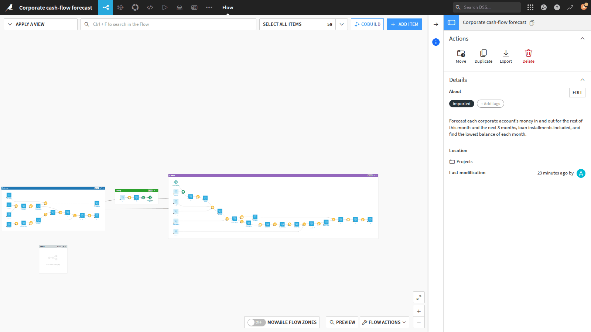

The whole pipeline on one canvas, in three **zones**: Data prep, Training, Inference. Squares are
**datasets**, round icons are **recipes** (the steps), the diamond is the **saved model**. A line between
zones is a dataset one zone reads from another. A zone header's buttons **build** it or **open** it alone.

### Data prep zone

Inputs on the left (`transactions`, `accounts`, `calendar`, `loan_schedule`). Prepare gives each transaction
a category and a flow (IN, EXPENSE, OBLIGATION); Group and Join recipes turn them into `daily_series` (money
in and expenses per day) and `daily_obligations` (installments ahead, from the schedule).

### Training zone

`daily_series` comes in (shared from Data prep, shown pale). Prepare keeps the history only → the
**training recipe** → the saved model.

### Inference zone

The model **scores** the future days → `forecast`. Installments are stacked in, then Group, Window and
Prepare recipes build `daily_balance_path`, `monthly_outlook` and `monthly_drivers` (far right).

### The code project's Flow

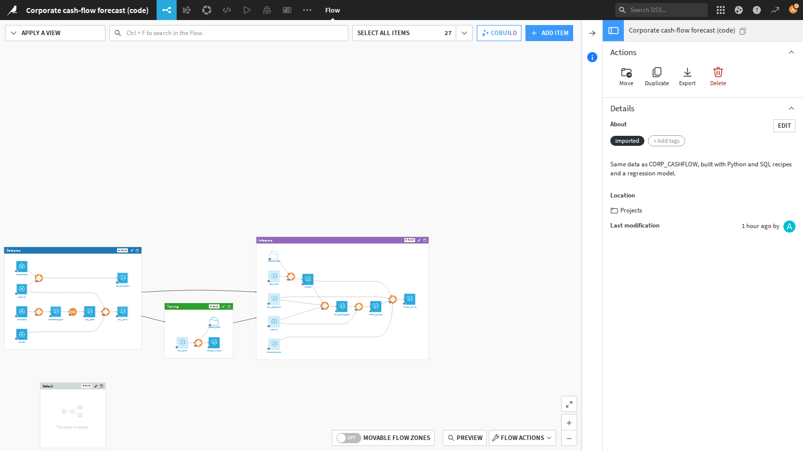

`CORP_CASHFLOW_CODE`: the same zones and outputs with 8 Python recipes and 1 SQL recipe. Fewer boxes: one
code recipe does what several visual recipes do.

---

## 2. Datasets and recipes

### A dataset

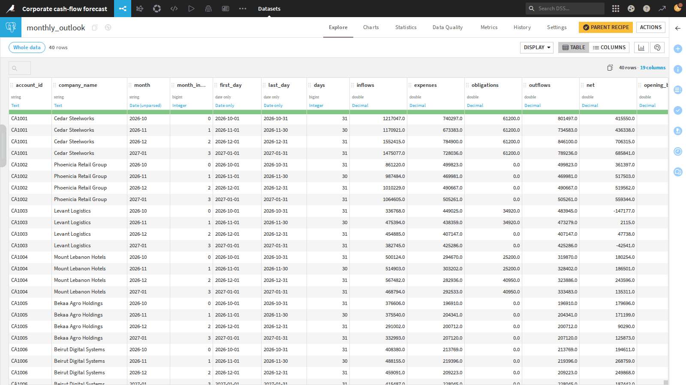

Double-click a dataset to **Explore** it. Tabs: Charts, Statistics, **Data Quality**, **Metrics**, History,
Settings. **Parent recipe** opens the recipe that writes it.

### Prepare recipe

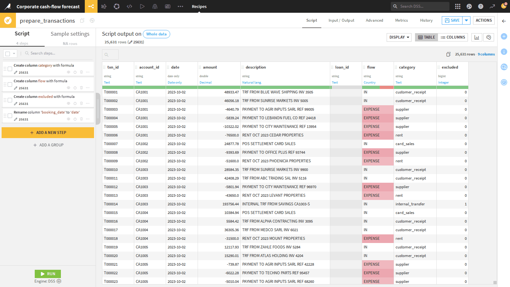

Steps on the left, applied top to bottom (here: the description rules → `category`, the sign → `flow`). The
preview on the right updates as you edit; each step can be switched off to see its effect. **Run** applies
it to all rows.

### Group recipe

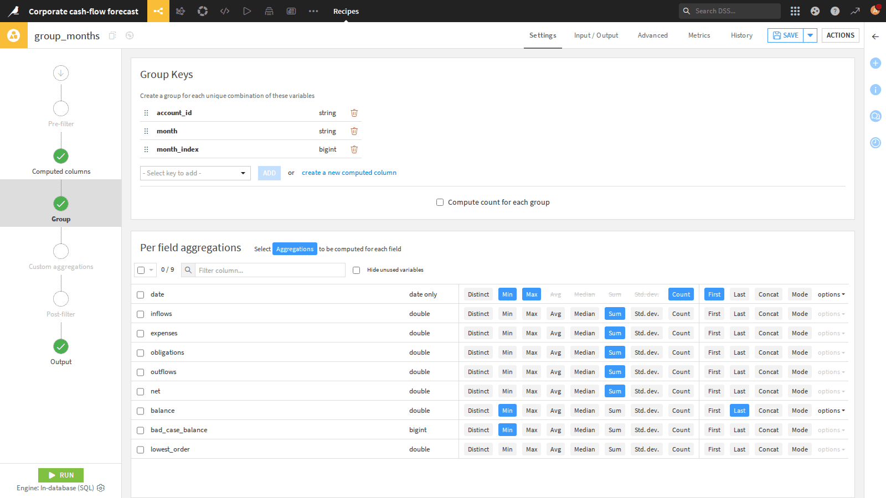

Keys and aggregations: here the days of `daily_balance_path` added up per account and month.

### Window recipe

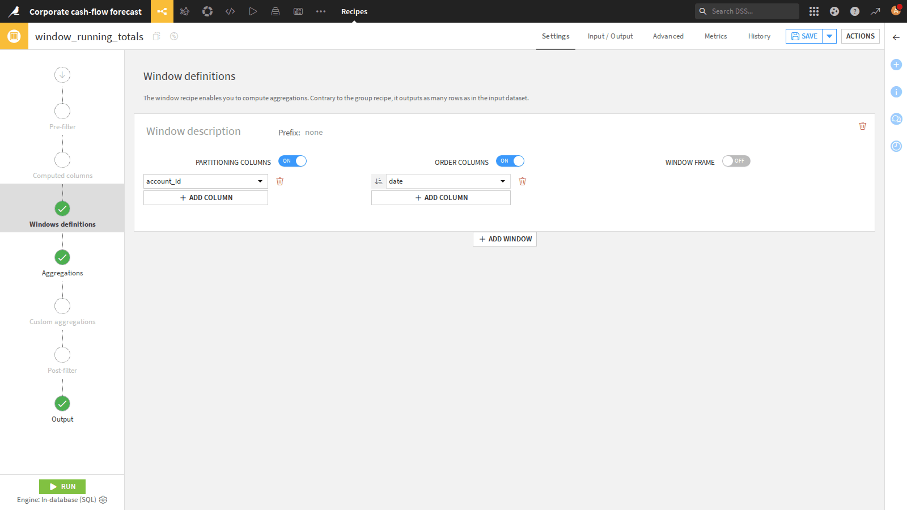

Running totals: per account, ordered by date, the cumulative net becomes the balance day by day.

### Python recipe (code project)

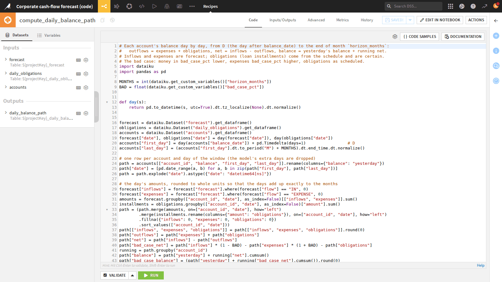

Inputs and outputs on the left, code in the middle. **Validate** checks it, **Run** runs it, **Edit in
notebook** opens it in Jupyter to try it line by line.

---

## 3. Models

### Lab: comparing algorithms

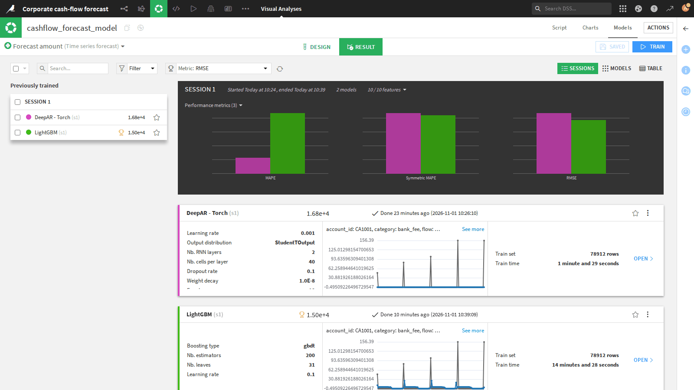

**Visual analyses** → the model's analysis. **Design** holds the settings (target, time, series ids,
horizon 123 days, calendar as external features, algorithms); **Result** lists each trained algorithm with
its scores on the back-test. The best is deployed to the Flow.

### Saved model

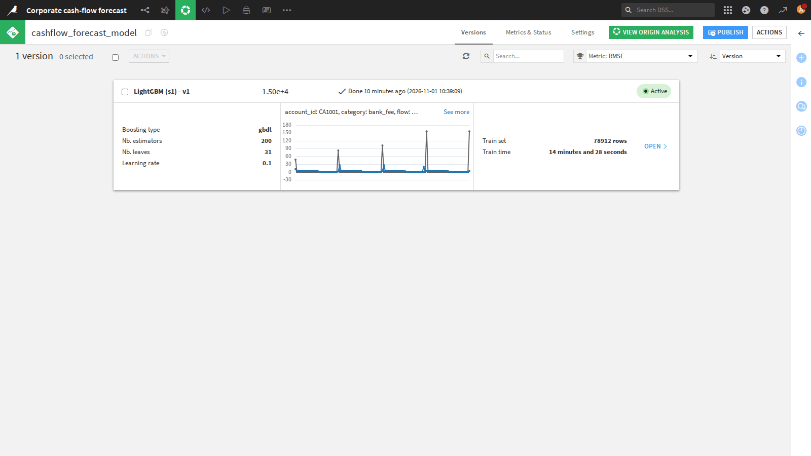

The diamond in the Flow. Each retrain adds a **version**; the **active** one is used for scoring. Make an
older one active to roll back.

### Code project: the model folder

The code project keeps its model as files in a **managed folder**: `model.pkl` and `model_info.json` (when
it was trained, its scores, its horizon; read by the model check).

---

## 4. Running things by hand

### Right-click an item

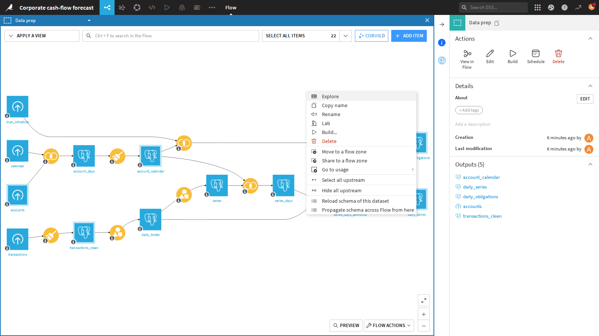

**Explore**, **Build…**, select or hide what is upstream / downstream, move or share to a zone. **Delete**
removes the dataset from the project: it is not the same as clearing it.

### Build…

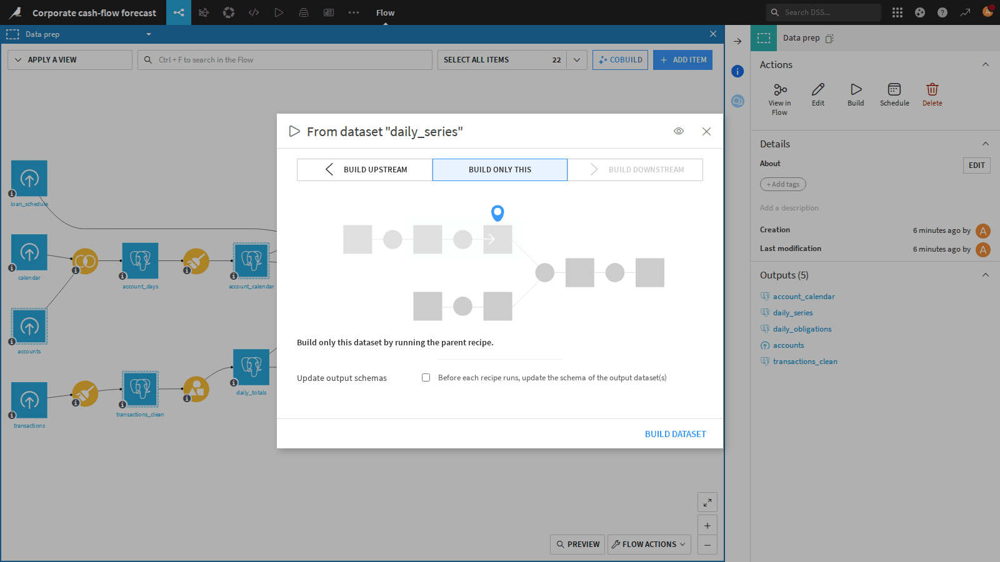

- **Build only this**: run only the recipe just before the dataset.
- **Build upstream**: also the recipes before it (only what changed, or everything).
- **Build downstream**: everything that depends on it.

### Actions panel: Clear data

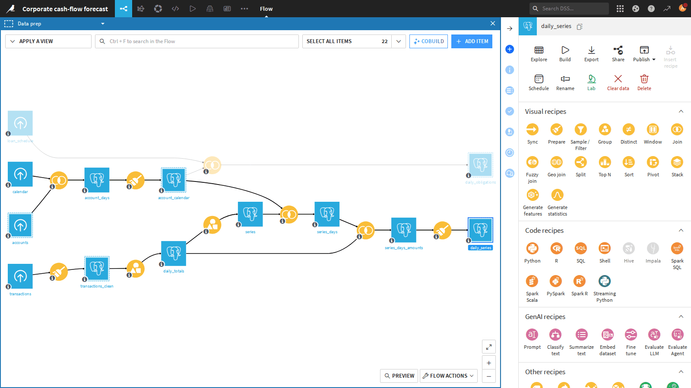

Click an item **once**: the right panel lists its actions: Explore, Build, **Clear data** (empties it,
building refills it), Delete, and the recipes you can add after it.

### Jobs

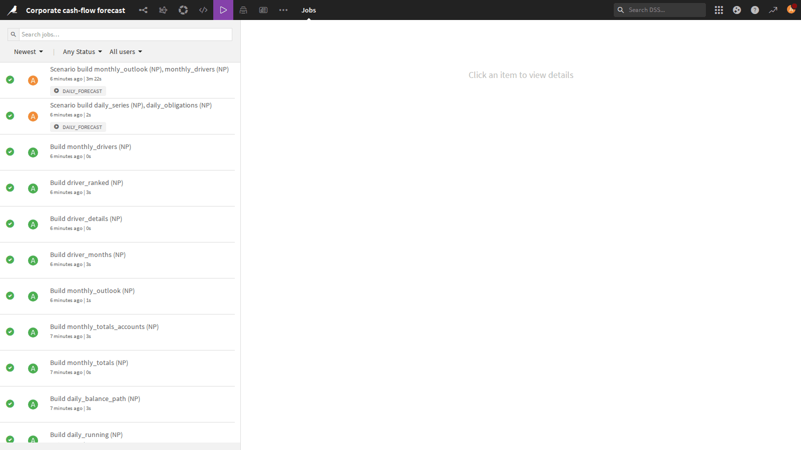

▷ → **Jobs**: every run, newest first. Click one to see its steps (one per recipe, green = OK, red = failed)
and the **log** of each: this is where to read an error.

---

## 5. Scenarios

A **scenario** is a saved list of **steps** that run one after the other. A **job** is one build of part of
the Flow; a scenario's build steps start jobs. The project has two scenarios, the same in both projects:

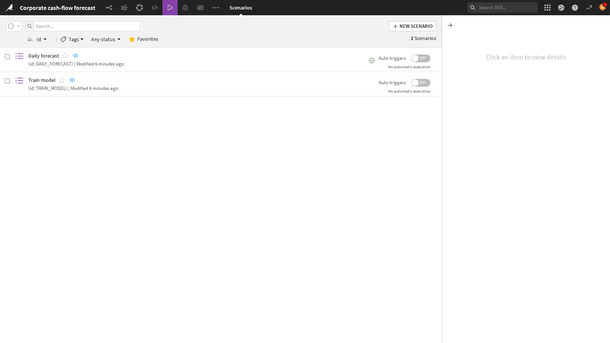

| Scenario | In plain words | When |
|---|---|---|
| **Train model** | check the inputs → refresh the daily series → train the model | about monthly |
| **Daily forecast** | check the inputs → refresh the daily series → is the model OK? → forecast and outputs → record the numbers | every day |

Open a scenario: **Settings** (when and how it runs), **Steps** (what it does), **Last runs** (what happened),
**History** (changes to it). **Run** (top right) starts it now.

### Settings

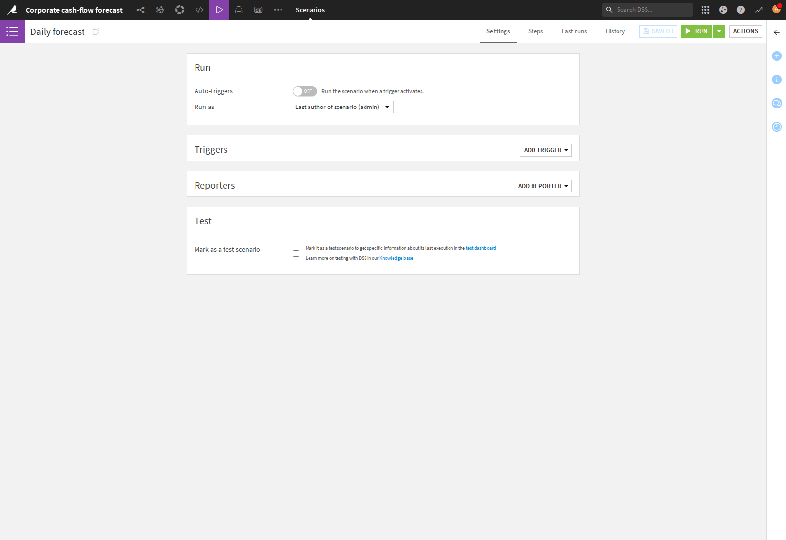

| Field | Meaning | Here |
|---|---|---|
| **Auto-triggers** | master switch: may the triggers below start the scenario on their own | off |
| **Run as** | whose permissions the run uses | admin |
| **Triggers** | when to start automatically: a time, a dataset change, a SQL query… | none: the Free Edition has no automatic triggers, so you click **Run** |
| **Reporters** | send a message after a run (e-mail, Slack, Teams…) | none |
| **Test** | mark as a test scenario, for DSS's test dashboard | no |

### Fields every step has

| Field | Meaning | Here |
|---|---|---|
| name box (next to the step type) | the label shown in Steps and Last runs | e.g. "Check the inputs" |
| **Run this step** | when the step runs: *If no prior step failed*, *Always*, *If a prior step failed*… | *If no prior step failed*: the first failure stops the scenario |
| **Ignore failure** | if ticked, a failure of this step doesn't fail the scenario | off |
| **Outcome on warnings** | what a warning makes of the step | Warning: shown in orange, the scenario goes on |
| **Maximal number of retries** | extra attempts before the step counts as failed | 0 |

### Step 1 (both scenarios): Check the inputs

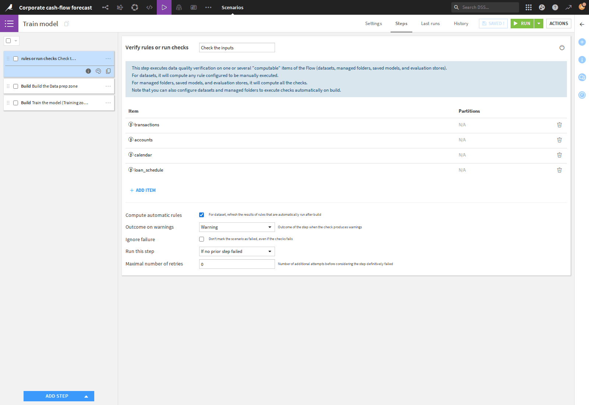

Type **Verify rules or run checks**. For each **item** (the four inputs: `transactions`, `accounts`,
`calendar`, `loan_schedule`), it runs the rules of that dataset's **Data Quality** tab: not empty, unique ids,
up to yesterday, every installment paid, calendar long enough.

- **Items** here are the datasets to *check*: they must exist, since they are the inputs.
- **Compute automatic rules**: also re-runs the rules set to run after each build.
- A rule in **error** fails the step, so the scenario stops before building anything from bad data.

### Step 2 (both scenarios): Build the Data prep zone

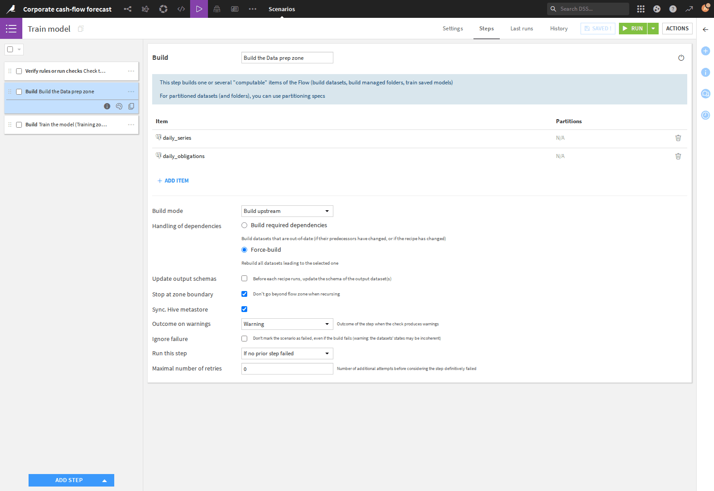

Type **Build**. This is where "items" matter most.

- **Items are targets**: what you want to be up to date when the step ends. Here `daily_series` and
  `daily_obligations`, the last datasets of the Data prep zone. They don't have to exist before: DSS finds
  the recipe that writes each item, then the recipes that feed that one, and so on, and runs them in order.
  Naming the last datasets is how you say "rebuild this whole chain".
- **Build mode**: *Build upstream* = the item and everything before it. The other choices in the list build
  only the item's own recipe, or what comes after it.
- **Handling of dependencies**: *Build required dependencies* rebuilds only what is out of date; *Force-build*
  rebuilds everything on the way. Force-build is used so yesterday's new transactions always flow through.
- **Stop at zone boundary**: ticked: walking back stops at the edge of the zone. Here the walk starts in
  Data prep and stays there.
- **Update output schemas**: off; the columns are fixed by the project's code. **Sync Hive metastore**:
  not used here.

### Train model, step 3: Train the model

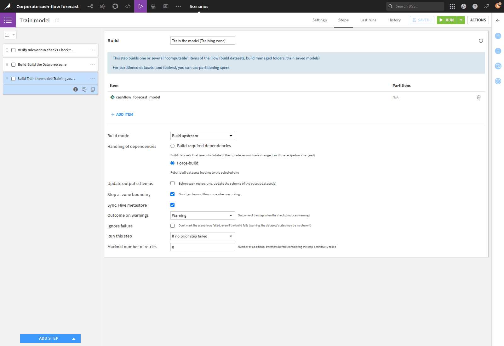

Type **Build**, with one item: the **saved model** (the green diamond). Building a saved model = training it
again on the current `daily_series`, testing it, and making the new version active. In the code project the
item is the `forecast_model` folder, built by the training recipe.

The model's rebuild setting is **explicit**: it is retrained only when it is itself an item, as here. Other
builds never retrain it by accident.

### Daily forecast, step 3: Check the model

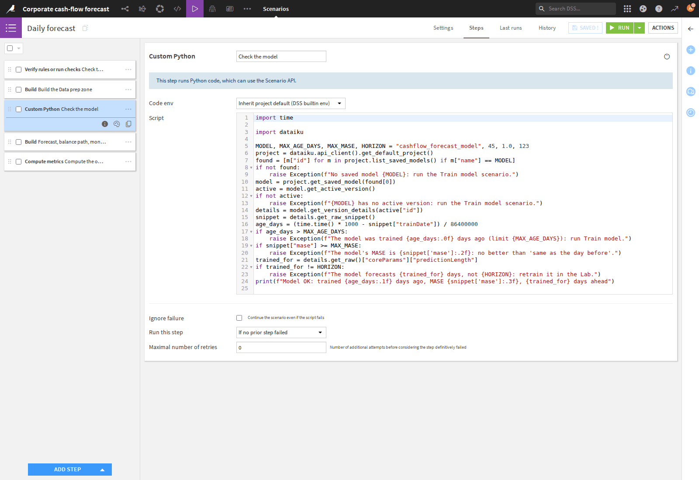

Type **Custom Python**: a script, run with the project's code env. It finds the saved model and its active
version, then checks:

| Check | Fails with | Fix |
|---|---|---|
| a model exists, with an active version | "No saved model…" / "…has no active version" | run **Train model** |
| trained ≤ 45 days ago | "The model was trained N days ago (limit 45)" | run **Train model** |
| MASE < 1 | "The model's MASE is …" | retrain, check the data |
| horizon = 123 days | "The model forecasts N days, not 123" | retrain |

`raise Exception(...)` fails the step and stops the scenario, so no forecast is made with a bad model.
`print(...)` writes "Model OK: …" in the step's log.

### Daily forecast, step 4: Forecast, balance path, months and drivers

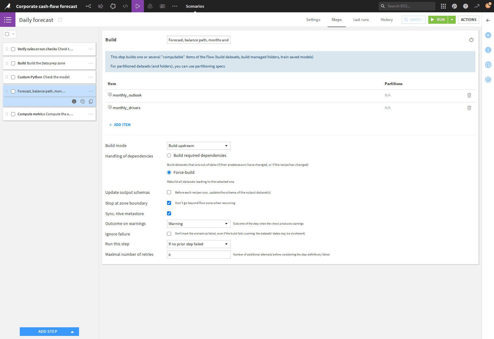

Type **Build**, items `monthly_outlook` and `monthly_drivers` (the last datasets of the Inference zone), *Build
upstream*, *Force-build*, **Stop at zone boundary** ticked. Walking back from them: drivers, months, balance
path, the installments, `forecast`, the Score recipe. It stops at the Inference zone's edge, so it uses the
model and `daily_series` as they are: the model is **not** retrained.

### Daily forecast, step 5: Compute the outlook metrics

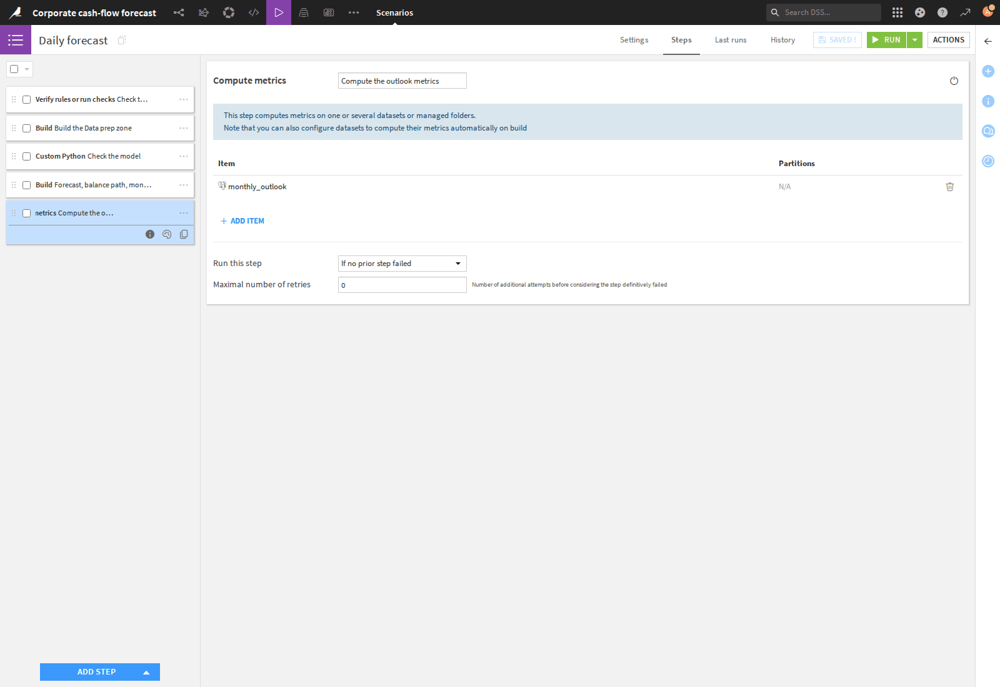

Type **Compute metrics**, item `monthly_outlook`. It computes that dataset's metrics (accounts at HIGH and
MEDIUM risk, lowest balance ahead) and stores them with the date, so the dashboard tiles show the latest values
and the **Metrics** tab keeps their history.

### Last runs

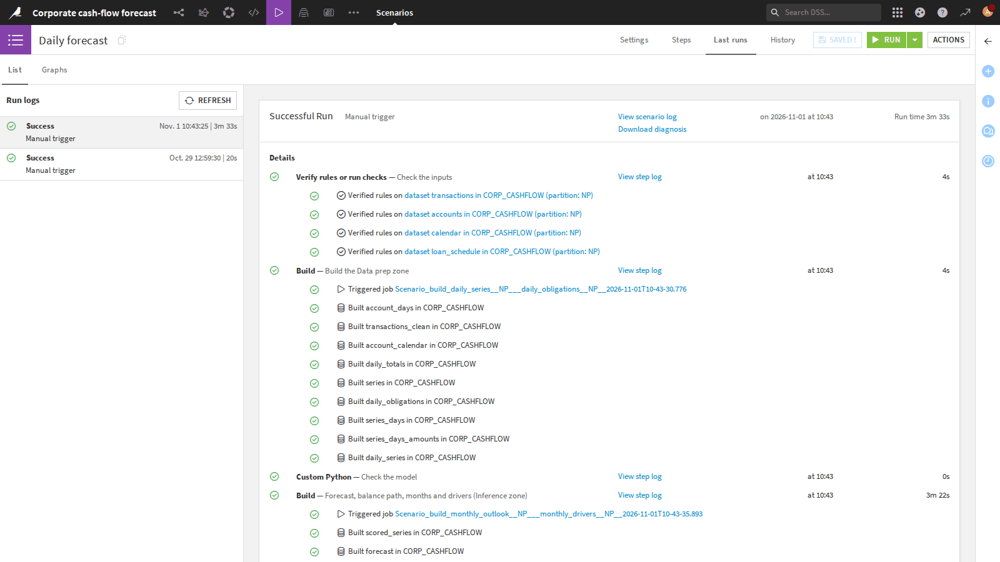

Each run with each step's outcome (green, orange = warning, red = failed), the datasets each build step built,
and links to the logs. The first place to look when a scenario fails.

---

## 6. Checks, metrics, dashboard, variables

### Data Quality

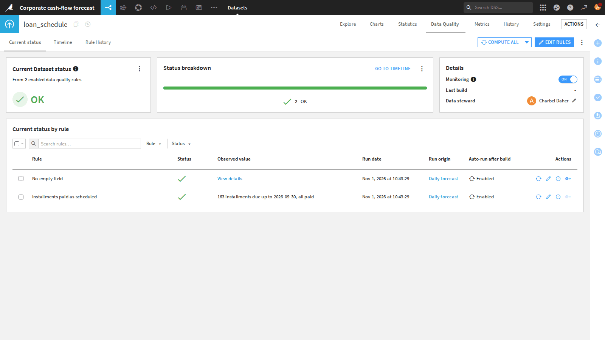

Dataset → **Data Quality**: each rule, its status and what it found (here: every past installment of the
loan schedule was paid). **Compute all** runs them now.

### Metrics

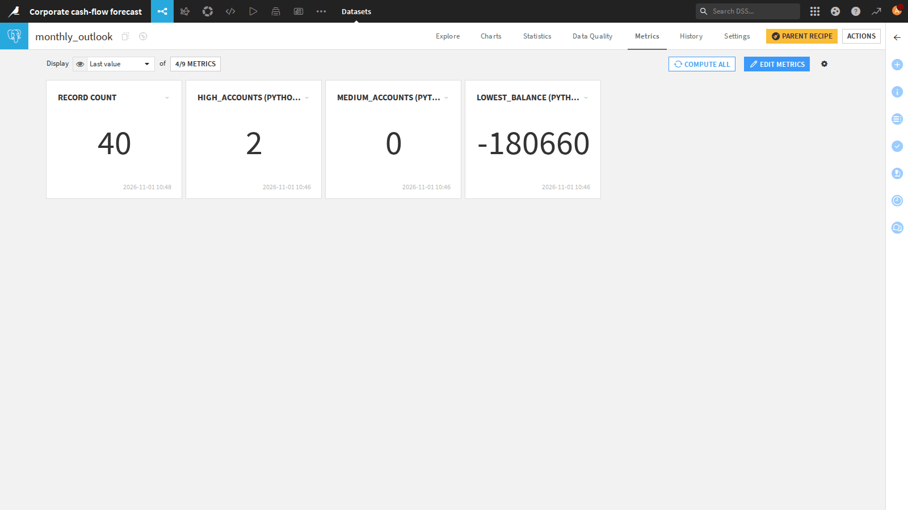

Dataset → **Metrics**: numbers recorded after each run (HIGH and MEDIUM accounts, lowest balance ahead).
Switch the display to history to follow them day by day.

### Dashboard

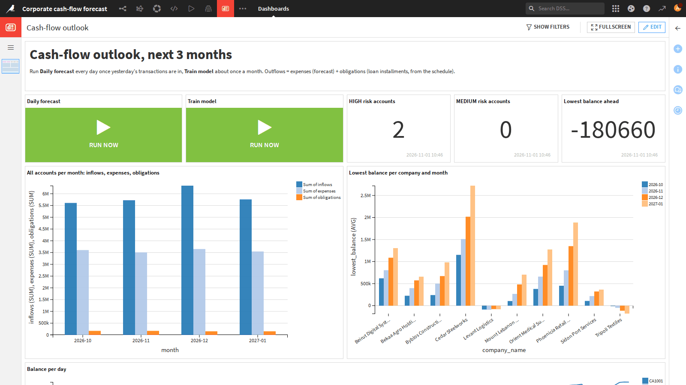

**Dashboards → Cash-flow outlook**: run buttons, the metrics, monthly charts, the balance per day, the monthly
and drivers tables.

### Project variables

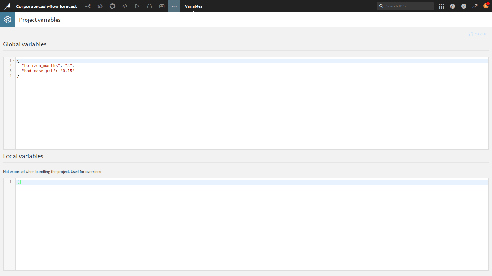

**… → Variables**: `horizon_months` = 3, `bad_case_pct` = 0.15, read by recipes and checks.

---

## 7. Cheat sheet

| To | Do |
|---|---|
| Run a scenario | ▷ → Scenarios → open it → **Run**; results in **Last runs** |
| Run one step | double-click the recipe → **Run** |
| Build a dataset | right-click it → **Build…** |
| Build a zone | **▶ BUILD** on the zone header |
| Clear a dataset | click it once → right panel → **Clear data** |
| See why a run failed | ▷ → Jobs → the red job → the red step → log |
| See checks and metrics | dataset → **Data Quality** / **Metrics** |
| Roll back the model (visual) | saved model → make another version active |

**When something fails**

| Message | Cause | Fix |
|---|---|---|
| A rule in error in *Check the inputs* | an input is incomplete (e.g. yesterday's transactions missing) | fix or reload it, run again |
| "installments due but not paid" | a scheduled installment has no payment | check the loan, or the `loan_id` on the payment |
| "No trained model" / "no active version" | model missing | run **Train model** |
| "trained N days ago (limit 45)" | model too old | run **Train model** |
| "MASE is ≥ 1" | model no better than "same as the day before" | retrain; check the data |
| "The calendar stops on …" | the calendar doesn't reach the end of month 3 | extend `calendar` |

**Changing things**: everything is defined in each project's `create_project.py`; running it **deletes and
recreates the project**, so changes made only in the UI are lost.

| To change | Edit |
|---|---|
| Months ahead, bad case | variables `horizon_months`, `bad_case_pct` |
| Description rules | `RULES` in `create_project.py` (visual) / `recipes/clean_transactions.py` (code) |
| Algorithms (visual) | `ALGORITHMS` in `corporate_cashflow/create_project.py` |
| Model features (code) | `corporate_cashflow_code/library/cashflow_model.py` |
| Input rules, metrics, dashboard | `corporate_cashflow/quality.py` (both projects) |

## Daily routine

1. Yesterday's transactions and balances are loaded.
2. Run **Daily forecast**.
3. If it fails, open **Last runs**: a red *Check the inputs* means bad or missing data (see the dataset's Data
   Quality tab); a red *Check the model* says what to do (usually: run **Train model**).
4. Read the dashboard: HIGH and MEDIUM accounts, the months, the drivers.
5. About once a month, run **Train model**.
