# Dataiku walkthrough: the cash-flow project, screen by screen

A tour of `CORP_CASHFLOW` (visual) in the order you would use it, plus the code project at the end.
What the project computes is in [`../CASHFLOW_GUIDE.md`](../CASHFLOW_GUIDE.md); this page shows **where things
are and how to work with them**. Screenshots are from DSS 15.2 on 29 Oct 2026.

**Top bar** (icons after the project name): **Flow** (first icon), **Visual analyses / Lab** (the circle),
**Code** (`</>`), **Run** (▷: Jobs and Scenarios), **Dashboards**, and **…** (Variables, Wiki, settings).

---

## 1. The Flow

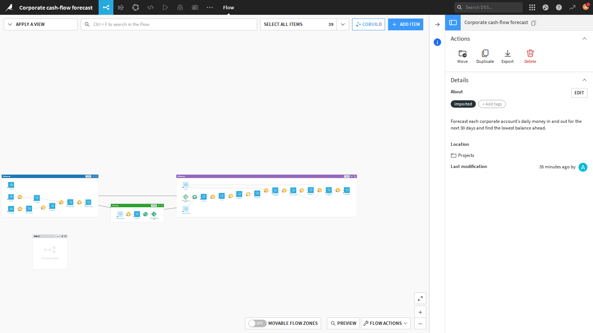

The whole pipeline on one canvas, grouped in **zones**: Data prep (blue), Training (green), Inference
(purple). The lines between zones are the datasets one zone reads from another. *Default* is empty: every
item is in a zone. The buttons on a zone's header **build** it or **open** it on its own (the screens below).

### Data prep zone

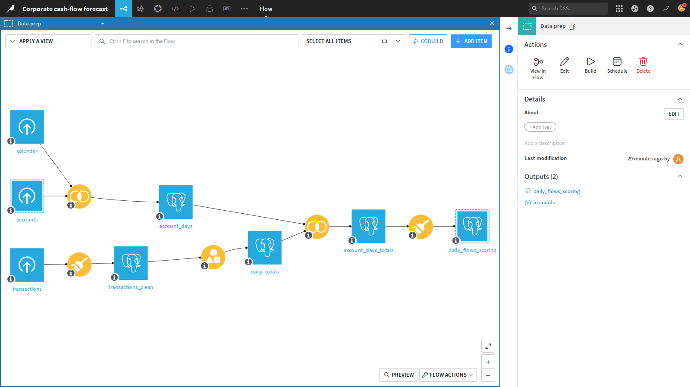

Blue squares are **datasets** (the arrow icon = uploaded file, the elephant = PostgreSQL table); round
icons are **recipes** (the steps). Read left to right: `transactions` → Prepare → `transactions_clean` →
Group → `daily_totals`; `calendar` × `accounts` → Join → `account_days` → Join → Prepare →
`daily_flows_scoring`. The right panel shows the zone's actions (**Build** the whole zone) and its outputs.

### Training zone

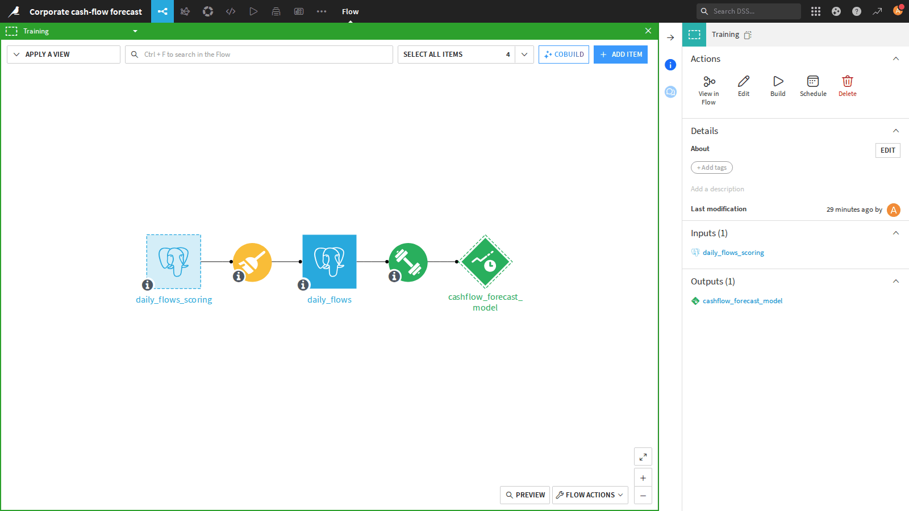

`daily_flows_scoring` is *shared* here (pale: it belongs to Data prep). Prepare keeps the history only →
`daily_flows` → the green **training recipe** → the green diamond, the **saved model**.

### Inference zone

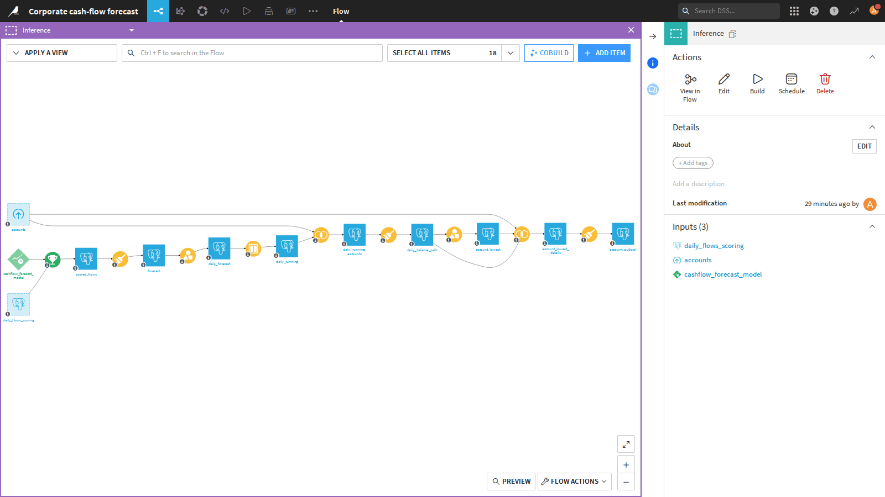

The saved model and `daily_flows_scoring` come in (shared); the **Score** recipe forecasts, then Group,
Window, Join and Prepare recipes build the balance path and `account_outlook` (far right).

---

## 2. Datasets and recipes

### A dataset

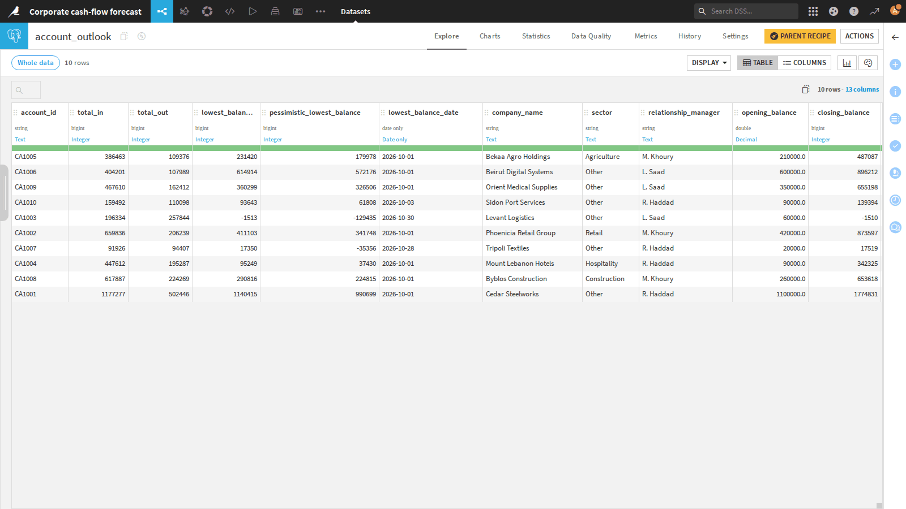

Double-click a dataset to **Explore** it. The tabs at the top: Charts, Statistics, **Data Quality**,
**Metrics**, History, Settings. **Parent recipe** opens the recipe that writes it.

### Prepare recipe

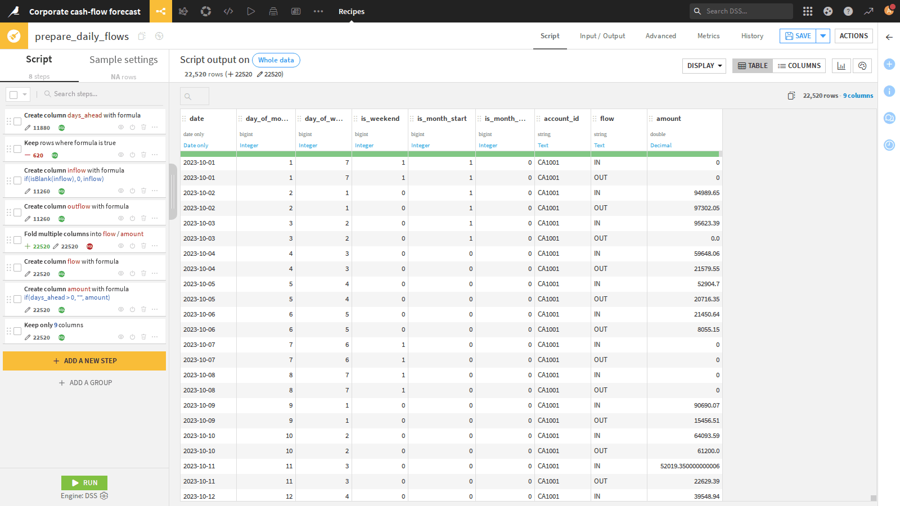

Steps on the left, run top to bottom (here: `days_ahead`, keep rows up to `${horizon_days}`, 0 on quiet
days, **Fold** in/out into rows...). The preview on the right updates as you edit; each step can be
switched off to see its effect. **Run** (bottom left) applies it to all rows.

### Group recipe

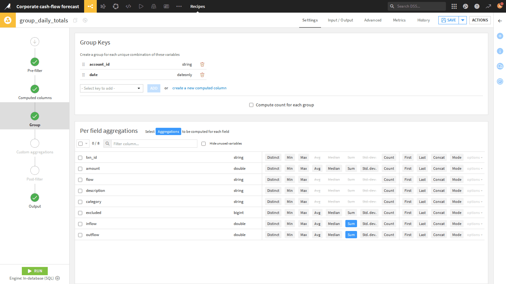

The left column is the recipe's pipeline (pre-filter, computed columns, group, post-filter). Here: keys
`account_id` + `date`, **Sum** of `inflow` and `outflow`. Join, Window and Score recipes look the same way.

### Python recipe (code project)

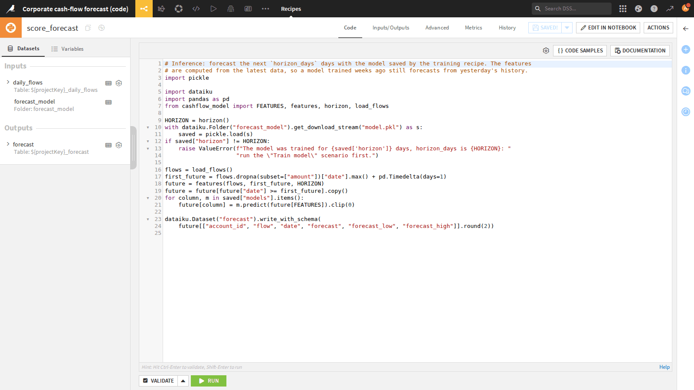

Inputs and outputs on the left, code in the middle. **Validate** checks it, **Run** runs it, **Edit in
notebook** opens it in Jupyter to try it line by line. `from cashflow_model import ...` loads the shared
code from the project library (`</>` → Libraries).

---

## 3. Models

### Lab: comparing algorithms

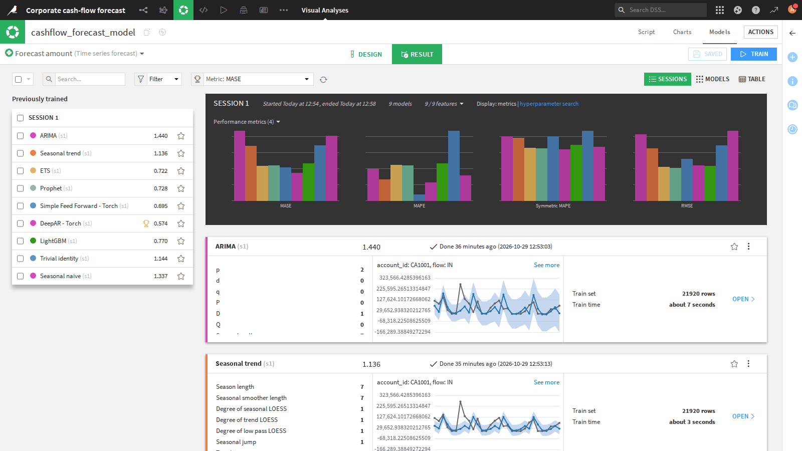

`cashflow_forecast_model` in **Visual analyses**. **Design** holds the settings (target, time, series,
horizon, algorithms); **Result** lists every trained model with its MASE (lower is better: DeepAR 0.574).
Each card shows the forecast vs the actual on the test days. Pick one → **Deploy** to put it in the Flow.

### Saved model: versions

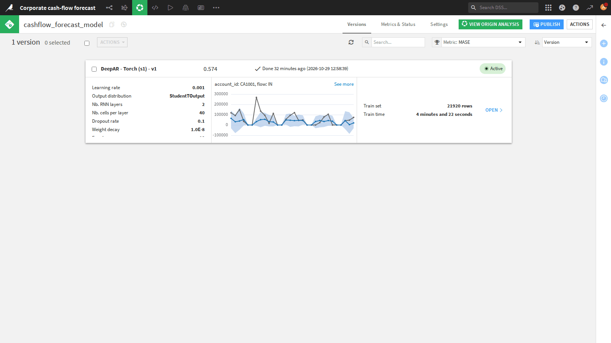

The green diamond in the Flow. Each retrain adds a **version**; the **Active** one is used for scoring.
Select another and make it active to roll back.

### Code project: the model folder

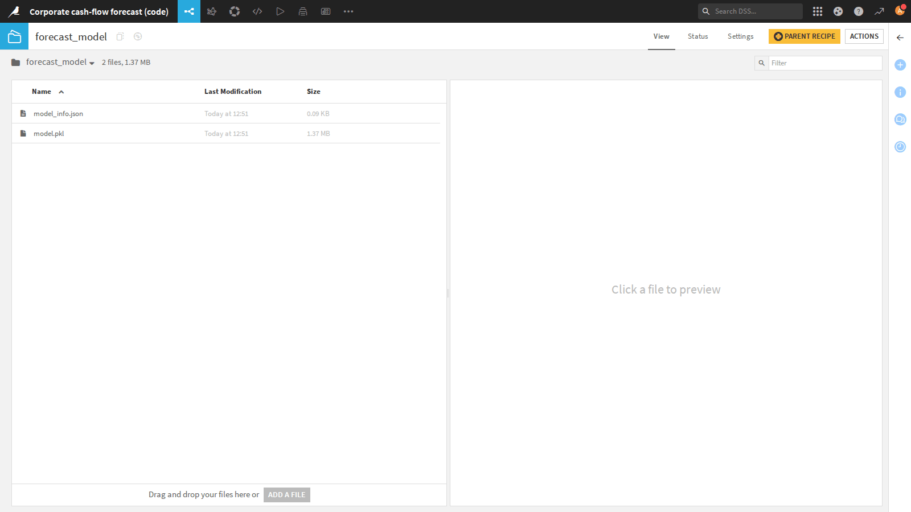

The code project keeps its model as files in a **managed folder**: `model.pkl` (the models) and
`model_info.json` (when it was trained, its MASE, its horizon; read by the model check).

---

## 4. Running things by hand

### Right-click an item

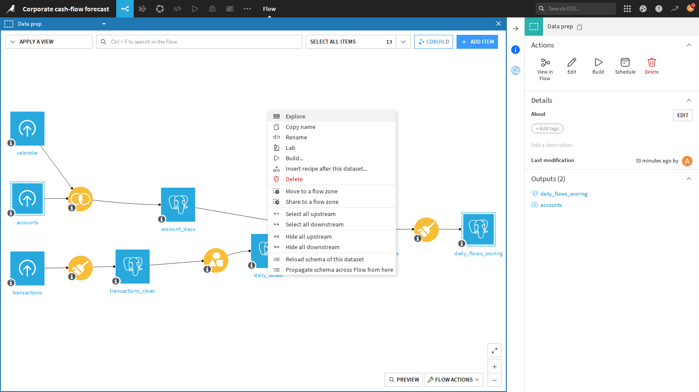

**Explore**, **Build…**, select or hide what is upstream / downstream, move or share to a zone.
**Delete** removes the dataset from the project: it is not the same as clearing it.

### Build…

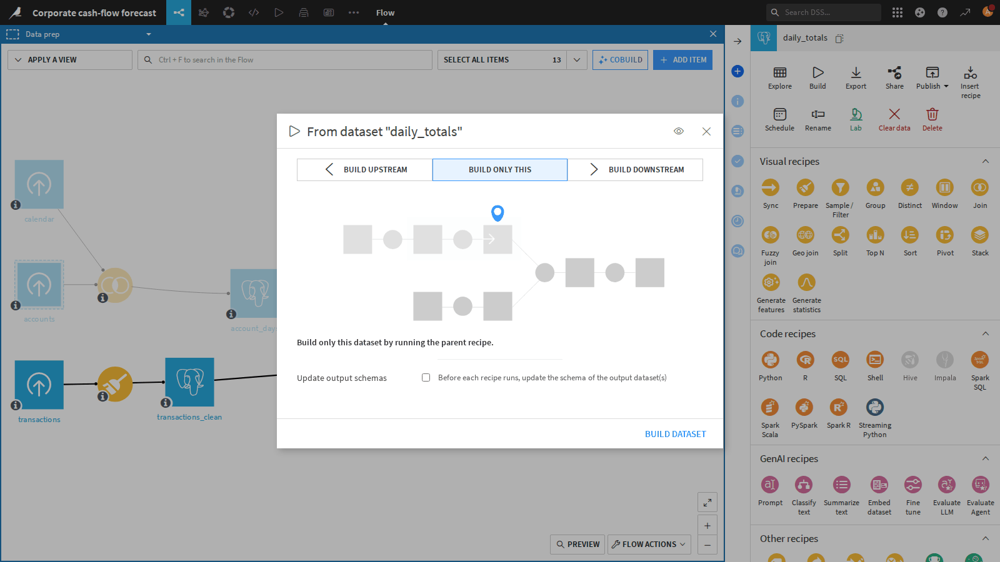

- **Build only this**: run only the recipe just before the dataset.
- **Build upstream**: also the recipes before it (choose: only what changed, or everything).
- **Build downstream**: everything that depends on it.

### Actions panel: Clear data

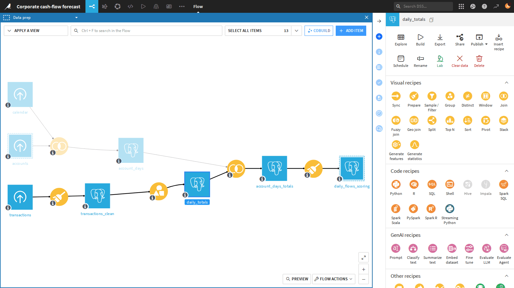

Click an item **once**; the right panel lists its actions: Explore, Build, Rename, **Clear data** (empties
it, building refills it), Delete, and the recipes you can add after it.

### Jobs: what ran

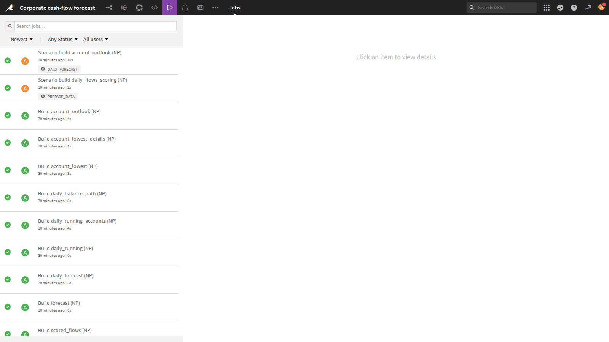

▷ → **Jobs**: every run, newest first. A job started by a scenario shows the scenario's name.

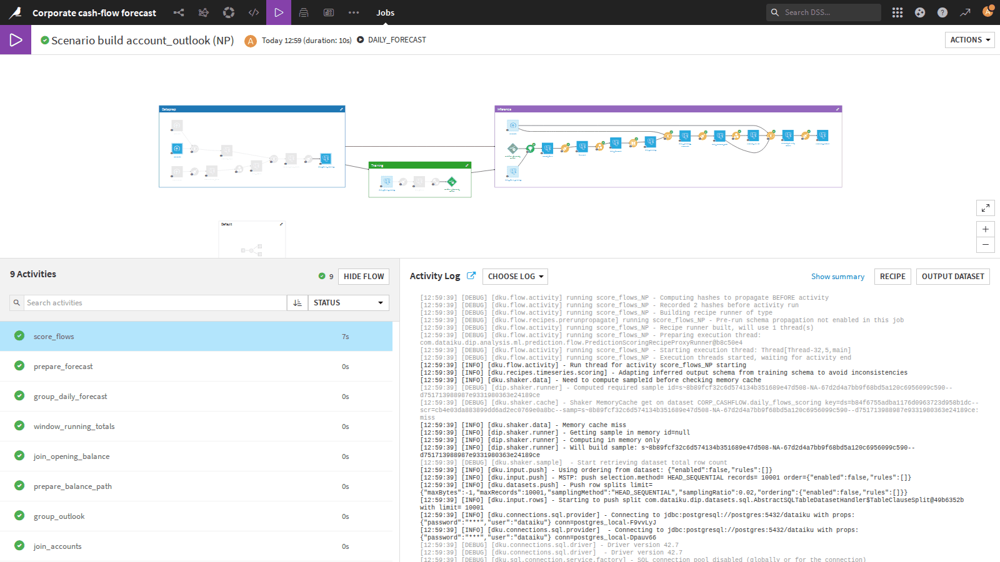

Click a job: the Flow it touched, its **activities** (one per recipe, green = OK, red = failed) and the
**log** of the selected one. This is where to read an error.

---

## 5. Scenarios

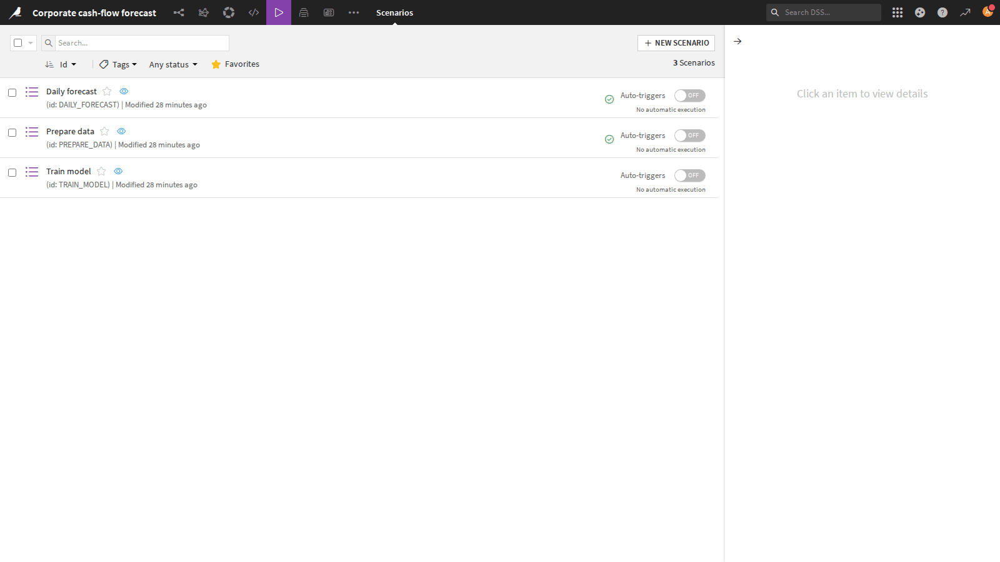

▷ → **Scenarios**: the three saved runs. *Auto-triggers* stay off: the Free Edition has no schedules, so
you click **Run** (or use the dashboard buttons).

| Scenario | What it does |
|---|---|
| Prepare data | checks the inputs, rebuilds the Data prep zone |
| Train model | Prepare data, then retrains the model |
| Daily forecast | Prepare data, checks the model, rebuilds the Inference zone, computes the metrics |

Open a scenario → **Steps** to see what it does; click a step to see its settings.

### Step: check the inputs

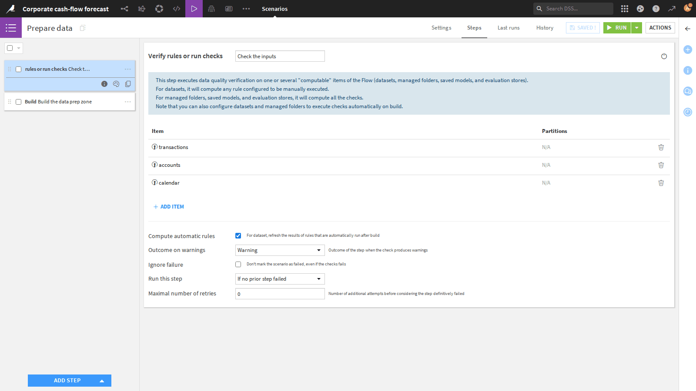

*Verify rules or run checks* on `transactions`, `accounts`, `calendar`. If a rule is in error, the step
fails and the scenario stops: nothing is built from bad data.

### Step: check the model

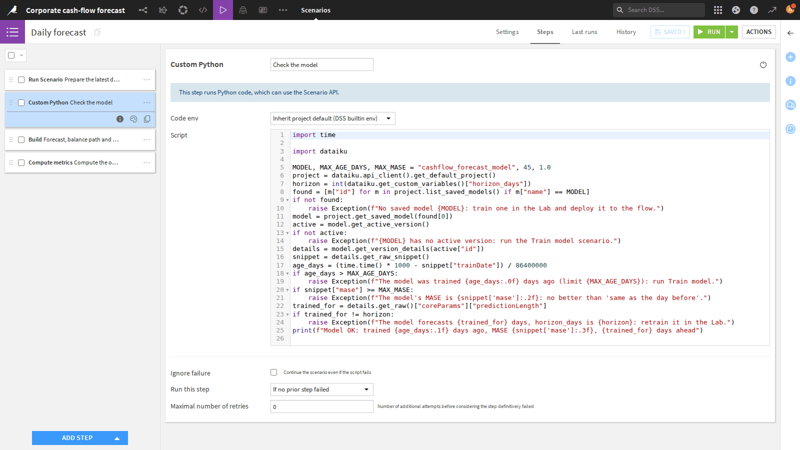

*Custom Python*: finds the saved model, its active version, its age, MASE and horizon; `raise Exception`
stops the scenario with that message. Change the limits here (45 days, MASE 1).

### Step: build a zone

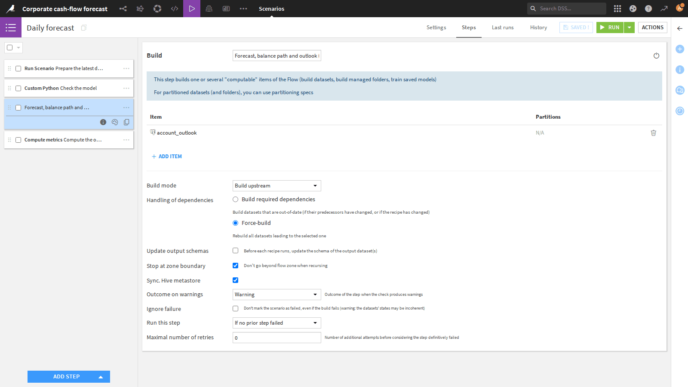

*Build* `account_outlook`, **Build upstream** + **Force-build**, with **Stop at zone boundary** ticked:
it rebuilds the Inference zone only, not the data prep or the model.

### Last runs

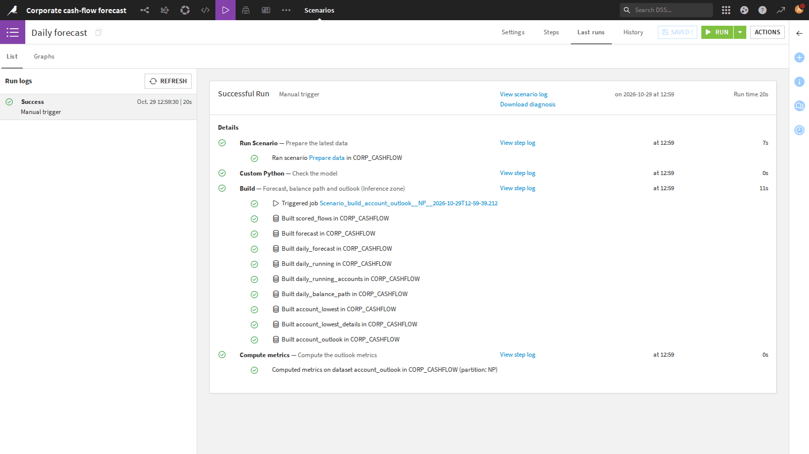

**Last runs**: each run, each step, each dataset built, with links to the step logs. The first place to
look when a scenario fails.

---

## 6. Checks and metrics

### Data Quality

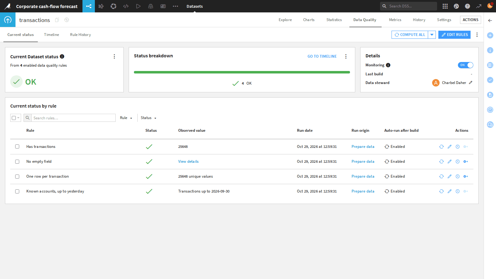

Dataset → **Data Quality**: each rule, its status and its observed value (here: 25,648 transactions, up to
2026-09-30). **Compute all** runs them now; **Edit rules** changes them. **Timeline** shows the history.

### Metrics

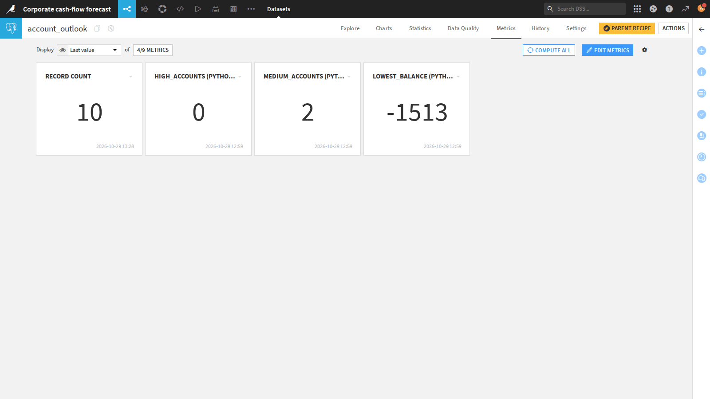

Dataset → **Metrics**: numbers recorded after each run (rows, HIGH and MEDIUM accounts, lowest balance).
Switch *Display* to history to see how they change from day to day.

---

## 7. Dashboard

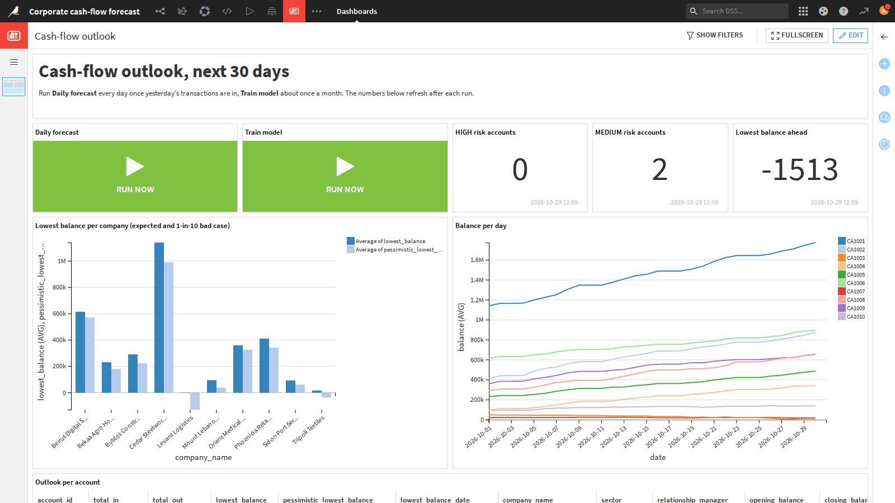

**Dashboards → Cash-flow outlook**: run buttons for the two scenarios, the latest metrics, the lowest
balance per company (expected and 1-in-10 bad case), the balance per day per account, and the outlook
table. **Edit** to move tiles or add charts (from any dataset's Charts tab → *Publish*).

---

## 8. Project variables

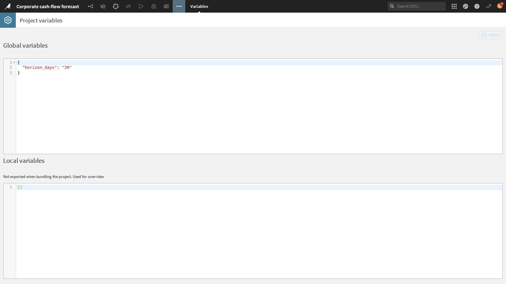

**… → Variables**: `horizon_days` = 30, read by recipes as `${horizon_days}` and by the checks. The Lab
model has its own horizon (Design → Forecasting parameters): change both, then run **Train model**.

---

## 9. The code project

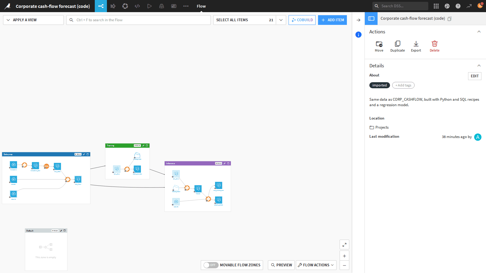

`CORP_CASHFLOW_CODE`: the same zones, scenarios, checks and dashboard, with 5 Python + 1 SQL recipes and
the model in a folder instead of the Lab.

---

## Daily routine

1. Yesterday's transactions and balances are loaded.
2. Run **Daily forecast** (scenarios page or dashboard button).
3. If it fails, open **Last runs**: a red *Check the inputs* means bad or missing data (see the dataset's
   Data Quality tab); a red *Check the model* says what to do (usually: run **Train model**).
4. Read the dashboard: HIGH / MEDIUM accounts, and when the lowest balance happens.
5. About once a month, run **Train model**.

> Changes made in the UI are lost when the project is redeployed with `create_project.py`. Try things in
> the UI, then put what you keep into the code.
