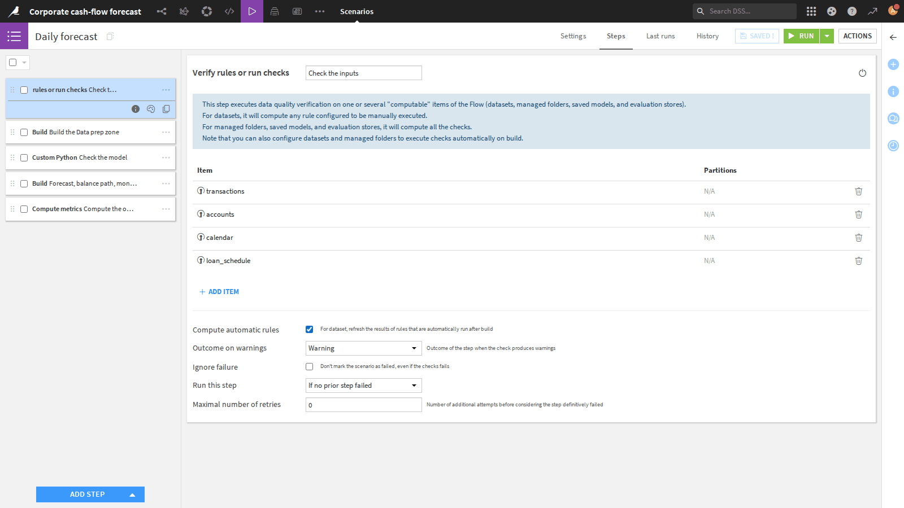
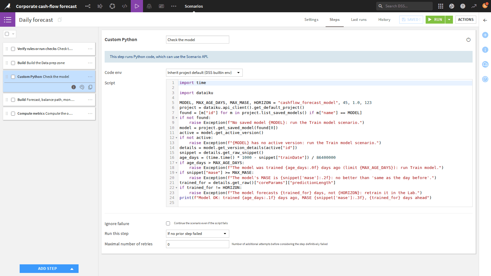
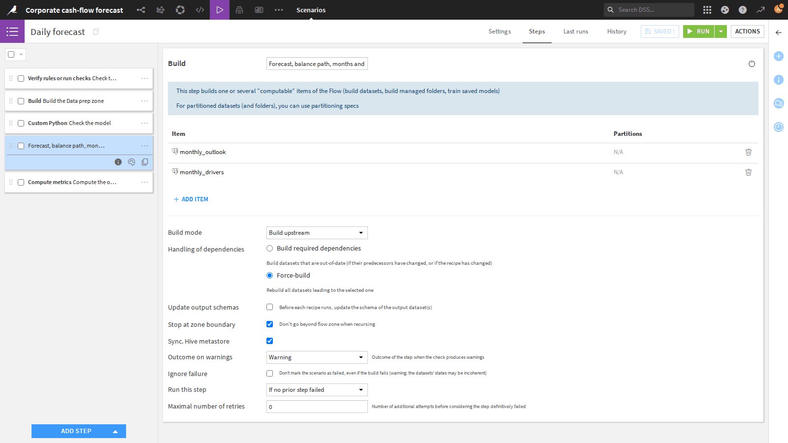

# Dataiku walkthrough: the cash-flow projects, screen by screen

Where things are in Dataiku DSS and how to work with them, using `CORP_CASHFLOW` (visual) and
`CORP_CASHFLOW_CODE` (code). What the forecast computes is in `HOW_FORECASTING_WORKS.html`.

**Top bar** (icons after the project name): **Flow** (first icon), **Visual analyses / Lab** (the circle),
**Code** (`</>`), **Run** (▷: Jobs and Scenarios), **Dashboards**, and **…** (Variables, Wiki, settings).

---

## 1. The Flow

The whole pipeline on one canvas, in three **zones**: Data prep, Training, Inference. Squares are
**datasets**, round icons are **recipes** (the steps), the diamond is the **saved model**. A line between
zones is a dataset one zone reads from another. A zone header's buttons **build** it or **open** it alone.

### Data prep zone

Inputs on the left (`transactions`, `accounts`, `calendar`, `loan_schedule`). Prepare gives each transaction
a category and a flow (IN, EXPENSE, OBLIGATION); Group and Join recipes turn them into `daily_series` (money
in and expenses per day) and `daily_obligations` (installments ahead, from the schedule).

### Training zone

`daily_series` comes in (shared from Data prep, shown pale). Prepare keeps the history only → the
**training recipe** → the saved model.

### Inference zone

The model **scores** the future days → `forecast`. Installments are stacked in, then Group, Window and
Prepare recipes build `daily_balance_path`, `monthly_outlook` and `monthly_drivers` (far right).

### The code project's Flow

`CORP_CASHFLOW_CODE`: the same zones and outputs with 8 Python recipes and 1 SQL recipe. Fewer boxes: one
code recipe does what several visual recipes do.

---

## 2. Datasets and recipes

### A dataset

Double-click a dataset to **Explore** it. Tabs: Charts, Statistics, **Data Quality**, **Metrics**, History,
Settings. **Parent recipe** opens the recipe that writes it.

### Prepare recipe

Steps on the left, applied top to bottom (here: the description rules → `category`, the sign → `flow`). The
preview on the right updates as you edit; each step can be switched off to see its effect. **Run** applies
it to all rows.

### Group recipe

Keys and aggregations: here the days of `daily_balance_path` added up per account and month.

### Window recipe

Running totals: per account, ordered by date, the cumulative net becomes the balance day by day.

### Python recipe (code project)

Inputs and outputs on the left, code in the middle. **Validate** checks it, **Run** runs it, **Edit in
notebook** opens it in Jupyter to try it line by line.

---

## 3. Models

### Lab: comparing algorithms

**Visual analyses** → the model's analysis. **Design** holds the settings (target, time, series ids,
horizon 123 days, calendar as external features, algorithms); **Result** lists each trained algorithm with
its scores on the back-test. The best is deployed to the Flow.

### Saved model

The diamond in the Flow. Each retrain adds a **version**; the **active** one is used for scoring. Make an
older one active to roll back.

### Code project: the model folder

The code project keeps its model as files in a **managed folder**: `model.pkl` and `model_info.json` (when
it was trained, its scores, its horizon; read by the model check).

---

## 4. Running things by hand

### Right-click an item

**Explore**, **Build…**, select or hide what is upstream / downstream, move or share to a zone. **Delete**
removes the dataset from the project: it is not the same as clearing it.

### Build…

- **Build only this**: run only the recipe just before the dataset.
- **Build upstream**: also the recipes before it (only what changed, or everything).
- **Build downstream**: everything that depends on it.

### Actions panel: Clear data

Click an item **once**: the right panel lists its actions: Explore, Build, **Clear data** (empties it,
building refills it), Delete, and the recipes you can add after it.

### Jobs

▷ → **Jobs**: every run, newest first. Click one to see its steps (one per recipe, green = OK, red = failed)
and the **log** of each: this is where to read an error.

---

## 5. Scenarios

▷ → **Scenarios**: the two saved runs. The Free Edition has no schedules: click **Run** (or use the dashboard
buttons).

| Scenario | Steps |
|---|---|
| **Train model** | check the inputs → build Data prep → train the model |
| **Daily forecast** | check the inputs → build Data prep → check the model → build Inference → metrics |

### Step: check the inputs

Verifies the Data Quality rules of the four inputs. A rule in error stops the scenario: nothing is built from
bad data.

### Step: check the model

Custom Python: the model must exist, be at most 45 days old, have a MASE below 1 and a 123-day horizon.
`raise Exception(...)` stops the scenario with that message.

### Step: build a zone

Build the outputs with **Stop at zone boundary** ticked: only this zone's recipes run.

### Last runs

Each run, each step, each dataset built, with links to the logs. The first place to look when a scenario
fails.

---

## 6. Checks, metrics, dashboard, variables

### Data Quality

Dataset → **Data Quality**: each rule, its status and what it found (here: every past installment of the
loan schedule was paid). **Compute all** runs them now.

### Metrics

Dataset → **Metrics**: numbers recorded after each run (HIGH and MEDIUM accounts, lowest balance ahead).
Switch the display to history to follow them day by day.

### Dashboard

**Dashboards → Cash-flow outlook**: run buttons, the metrics, monthly charts, the balance per day, the monthly
and drivers tables.

### Project variables

**… → Variables**: `horizon_months` = 3, `bad_case_pct` = 0.15, read by recipes and checks.

---

## 7. Cheat sheet

| To | Do |
|---|---|
| Run a scenario | ▷ → Scenarios → open it → **Run**; results in **Last runs** |
| Run one step | double-click the recipe → **Run** |
| Build a dataset | right-click it → **Build…** |
| Build a zone | **▶ BUILD** on the zone header |
| Clear a dataset | click it once → right panel → **Clear data** |
| See why a run failed | ▷ → Jobs → the red job → the red step → log |
| See checks and metrics | dataset → **Data Quality** / **Metrics** |
| Roll back the model (visual) | saved model → make another version active |

**When something fails**

| Message | Cause | Fix |
|---|---|---|
| A rule in error in *Check the inputs* | an input is incomplete (e.g. yesterday's transactions missing) | fix or reload it, run again |
| "installments due but not paid" | a scheduled installment has no payment | check the loan, or the `loan_id` on the payment |
| "No trained model" / "no active version" | model missing | run **Train model** |
| "trained N days ago (limit 45)" | model too old | run **Train model** |
| "MASE is ≥ 1" | model no better than "same as the day before" | retrain; check the data |
| "The calendar stops on …" | the calendar doesn't reach the end of month 3 | extend `calendar` |

**Changing things**: everything is defined in each project's `create_project.py`; running it **deletes and
recreates the project**, so changes made only in the UI are lost.

| To change | Edit |
|---|---|
| Months ahead, bad case | variables `horizon_months`, `bad_case_pct` |
| Description rules | `RULES` in `create_project.py` (visual) / `recipes/clean_transactions.py` (code) |
| Algorithms (visual) | `ALGORITHMS` in `corporate_cashflow/create_project.py` |
| Model features (code) | `corporate_cashflow_code/library/cashflow_model.py` |
| Input rules, metrics, dashboard | `corporate_cashflow/quality.py` (both projects) |

## Daily routine

1. Yesterday's transactions and balances are loaded.
2. Run **Daily forecast**.
3. If it fails, open **Last runs**: a red *Check the inputs* means bad or missing data (see the dataset's Data
   Quality tab); a red *Check the model* says what to do (usually: run **Train model**).
4. Read the dashboard: HIGH and MEDIUM accounts, the months, the drivers.
5. About once a month, run **Train model**.
